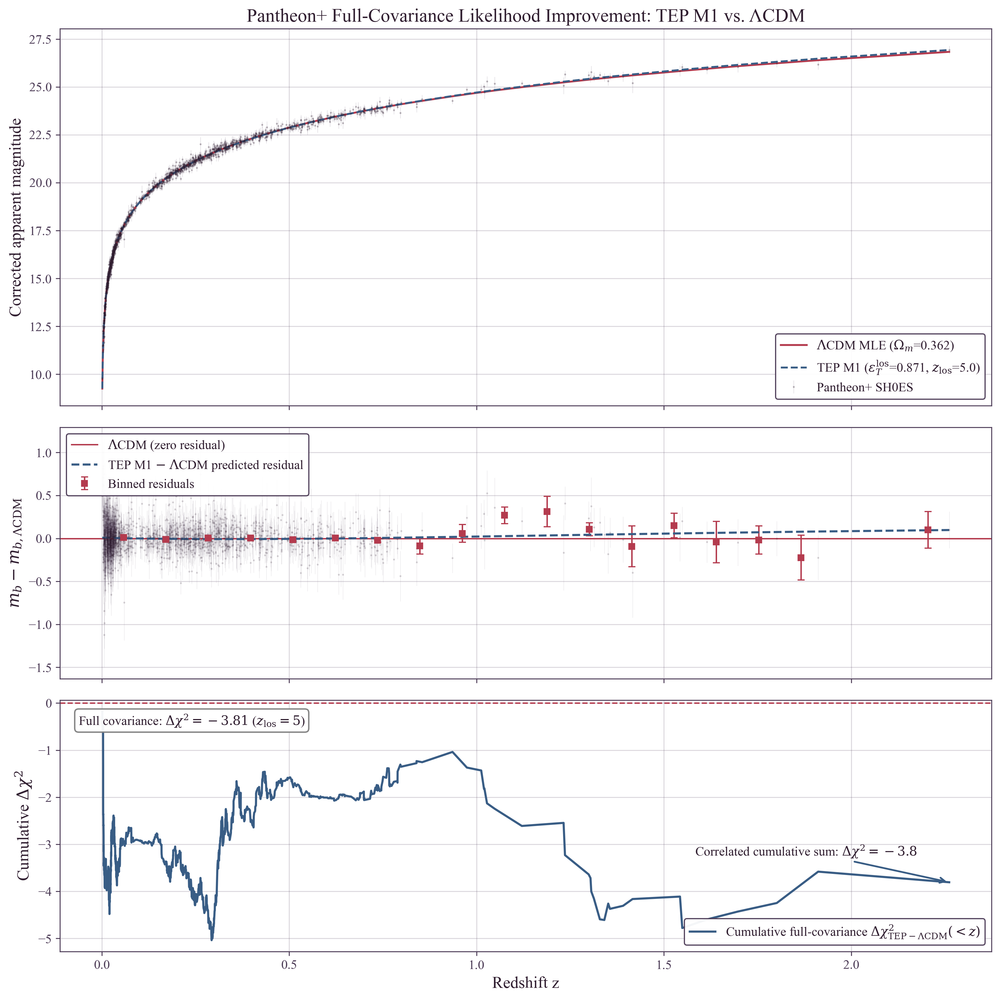
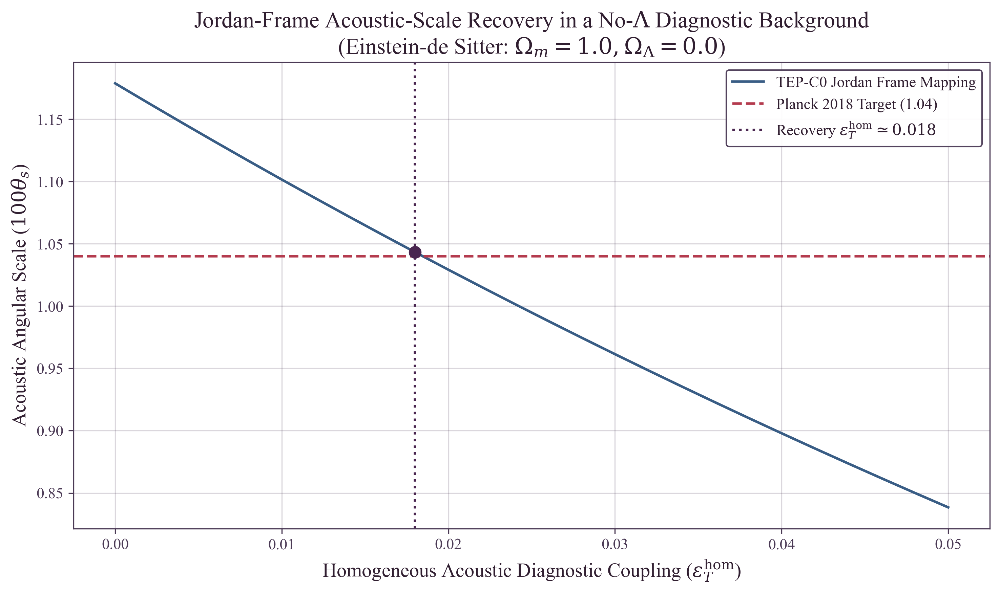
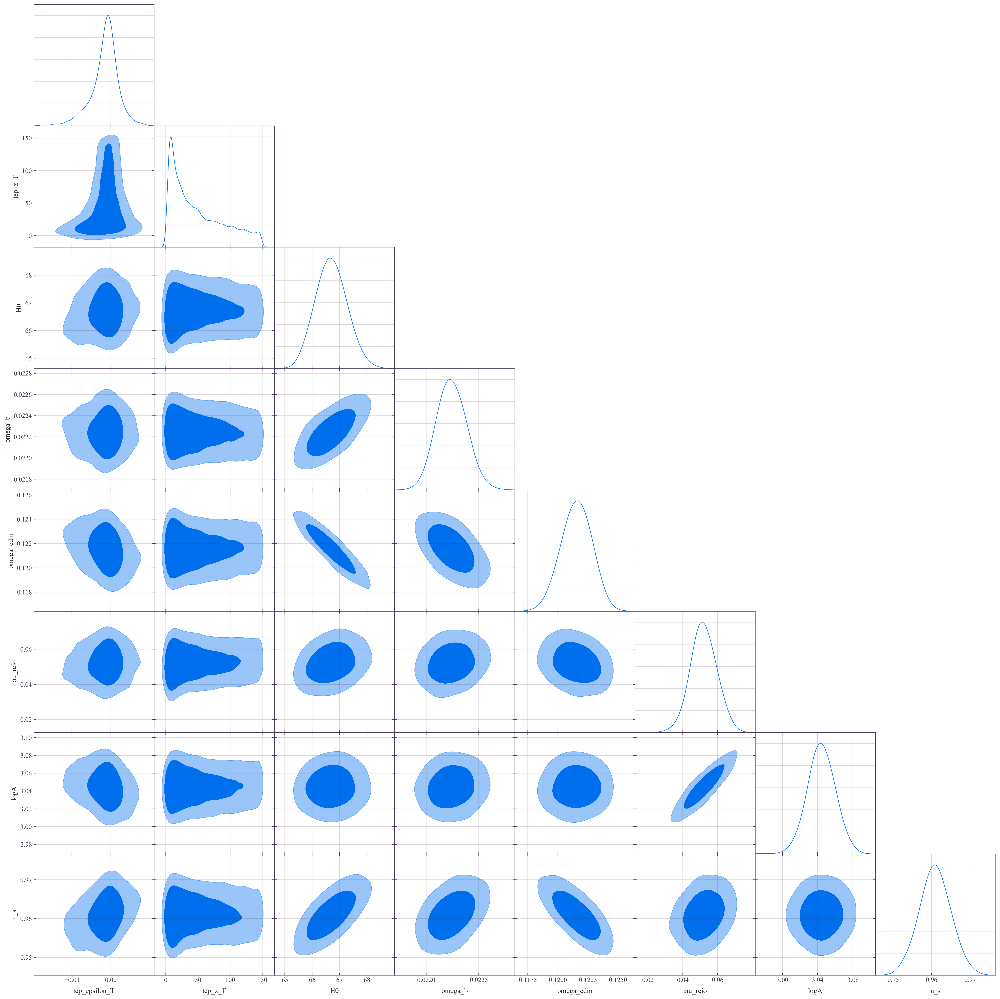
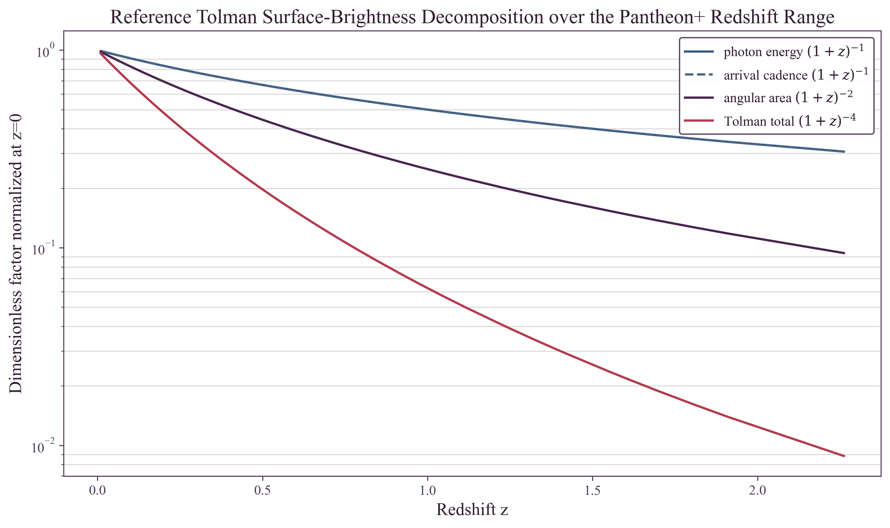

# Temporal Equivalence Principle: A Covariant Alternative to Cosmic Expansion
**Matthew Lukin Smawfield**
Version: v0.4 (Athens)
First published: 5 July 2026 - Last updated: 17 October 2026
DOI: 10.5281/zenodo.20370143

---

## Abstract

This paper presents a direct empirical challenge to the necessity of primitive cosmic expansion. In the Temporal Equivalence Principle framework, observed redshift is reconstructed as conformal proper-time transport, $1+z=A_0/A_{\text{em}}$ rather than as stretching of a spatial scale factor. Standard cosmology interprets observational redshift and luminosity distance scaling as evidence of a stretching spatial metric, parameterized by the Friedmann-Lemaître-Robertson-Walker (FLRW) scale factor $a(t)$. The observational role played by the FLRW scale factor is mapped, within the TEP conformal-frame construction, onto the temporal clock-rate field $A(\phi)$. In the tested late-time background sector, the perceived acceleration normally attributed to dark energy, $\Lambda$, is reconstructed as the kinetic energy density of the Temporal Shear field, $\Omega_\phi$.

The core relation is $1+z = A_0/A_{\text{em}}$. In the static conformal interpretation developed here, intergalactic separations are not treated as primitively expanding; the apparent expansion is reconstructed through temporal transport. In this framework, the limit conventionally written as $a\to0$ is re-expressed as $A_{\text{clock}}\to0$: a TEP temporal-horizon boundary of observational clock transport, not a zero-volume spatial singularity. The temporal-horizon background and linear-mode closure are supplied by companion papers TEP-TH and TEP-HC; C0 imports and cross-checks the TEP-HC linear-growth output while focusing on the empirical supernova-sector test.

Using 1,701 Pantheon+ Type Ia supernova measurements (1,543 distinct events) with the full covariance matrix and the official peculiar-velocity-corrected Hubble-diagram redshifts, a pure conformal reconstruction exactly reproduces the $\Lambda$CDM homogeneous distance-modulus relation, demonstrating that the background Hubble diagram does not uniquely select an expanding spatial metric. More strongly, the conservative physical no-$\Lambda$ temporal-shear branch with fixed line-of-sight turnover $z_{\rm los}=5$ (using the acoustic-sector scale as a conservative reference) improves the standardized supernova likelihood by $\Delta\chi^2 \simeq -3.81$ relative to baseline $\Lambda$CDM and achieves a Bayes factor of approximately 5.8, nominally in the "substantial" band of the Jeffreys scale — reported alongside its prior-sensitivity grid, and its reduction to BF $=0.52$-$0.96$ after low-redshift removal ($z>0.05$-$0.01$): the improvement localizes to the 77 SH0ES calibrators and the $z>1$ tail, so the SNe-only preference is evidence for a transport-shaped deviation whose physical attribution is tested by the joint and environmental channels. Under the canonical suppression exponent $n_T=2$ the free-$z_{\rm los}$ branch marginalizes the turnover scale, with its likelihood maximum at the admissible turnover $z_{\rm los}\simeq5.3$ and its posterior volume extending over the nearly flat unsuppressed tail, and returns BF $\approx$ 5.4, while the fixed $z_{\rm los}=100$ benchmark gives a comparable BF $\approx$ 5.4 ($\Delta\chi^2 \simeq -3.69$); the admissible branches thus saturate at a moderate, internally consistent level rather than at extreme amplification, and both standard dark-energy extensions (wCDM, CPL) return weaker evidence at matched or greater freedom. The conservative physical model with $z_{\rm los}=5$—which turns over before the acoustic epoch and is therefore consistent with the joint CMB bound on the homogeneous shear component—demonstrates that a matter-only temporal-shear geometry is competitive with $\Lambda$CDM in the late-time SNe distance-redshift sector. A single-history joint fit to Pantheon+, DESI DR2 BAO and the Planck acoustic angle (Step 03-14) selects the native Jordan-frame TEP background of Paper 18, which is preferred over $\Lambda$CDM by $\Delta\chi^2=-8.1$ ($\Delta{\rm AIC}=-4.1$), with the preference growing from DESI DR1 ($-6.3$) to DR2; the M1 kernel serves as the supernova-sector distance law. The same framework supplies a galaxy-mass-locked host-environment diagnostic from the nested clock-rate structure of the scalar sector: the transferred Cepheid response predicts the established massive-host-brighter orientation at the literature-step order, while overshooting the residual in the already host-corrected Pantheon+ product; freeing the response amplitude on the continuous per-supernova depth coordinate returns a $2.9\sigma$ detection in the predicted direction (deeper wells brighter) at roughly a tenth of the naive transfer normalization. The environmental prediction is tested directly: separating the corpus's two nested channels — ambient host/density depth, which enhances the transport amplitude, and within-host radial depth, which screens it — yields a two-channel modulation at permutation significance $p=0.036$ (1000 realisations) that survives redshift-projection, anchor-removal, band-pass, survey-offset, covariance-perturbation, leave-one-survey-out, and out-of-sample transfer controls, and re-derives with the correct signs inside each resolved host-association scheme independently — including positive transfer to held-out SDSS and DES; PS1MD transfer is negative; after jointly modeling the light-curve-quality amplitude structure that competes with it, the environmental attribution reaches $\Delta\chi^2\simeq-9.13$ ($p=0.015$ against 1000 whole-event permutations within survey-composition and redshift strata), concentrated in the transport-sensitive bulk. The predicted depth-response coefficient is measured directly on the per-supernova depth coordinate: $\hat\kappa_{\rm SN}=+3.2\times10^{4}\pm1.1\times10^{4}$ mag on Pantheon+ ($2.9\sigma$, predicted sign, calibrator-block localized, permutation $p<0.005$), replicated on the independent DES-Dovekie catalog at $+8.9\times10^{4}\pm2.3\times10^{4}$ ($3.9\sigma$, concentrated at $4.8\sigma$ in the high-mass half) — the joint direction is positive at $>4\sigma$ across two compilations with independent standardization, at a normalization consistent with channel-specific response projection.

Companion papers establish the theoretical foundations: TEP-HC (Paper 18) provides the Boltzmann-level acoustic-scale preservation proof under the native hi_class `tep_mode` implementation, and TEP-TH develops the nonsingular temporal-horizon closure. The current paper focuses on the empirical supernova-sector test and the deterministic falsification pipeline.

Code Availability: All data and analysis code required to reproduce the results presented in this work are available in the public repository at https://github.com/matthewsmawfield/TEP-C0.

Keywords: temporal equivalence principle, static conformal geometry, cosmology, dark energy, supernovae, Bayesian inference, modified gravity, temporal shear

# 1. Introduction: The Geometry of Time

Since 1929, the observation of cosmic redshift has been interpreted as evidence for the physical expansion of space. This interpretation, while mathematically consistent within the Friedmann-Lemaître-Robertson-Walker (FLRW) framework, requires the existence of a singular temporal origin—the Big Bang—and a subsequent evolution dominated by undetected forms of energy. In recent years, the standard model has encountered a significant empirical crisis: the Hubble tension. The persistent $5\sigma$ tension between local and global determinations of $H_0$ suggests that the underlying physical interpretation of redshift—and thus cosmic expansion—may be fundamentally incomplete.

This paper proposes a more fundamental alternative: that apparent cosmic expansion is a geometric misinterpretation of accumulated Temporal Shear. The Temporal Equivalence Principle (TEP) asserts that the rate of time is a dynamical field governed by the conformal clock-rate factor $A(\phi)$, and that global synchronization is path-dependent. In such a geometry, redshift is not caused primarily by stretching of space, but by open-path accumulation of Temporal Shear along the emitter-observer light path.

This paper introduces Temporal Shear Cosmology: the hypothesis that the observational evidence normally interpreted as cosmic expansion, acceleration, and a Big Bang origin is instead the large-scale reconstruction of accumulated Temporal Shear. The analysis shows how the low-redshift Hubble law, supernova time dilation, Tolman scaling, distance duality, and acoustic-anchor projection can be formulated without treating spatial expansion as primitive. By replacing the expansion-based scale factor with the Temporal Shear projection $\Sigma_\parallel^{\text{eff}}$, the Hubble tension is reinterpreted, and the Big Bang is recovered as an effective integrable reconstruction of a stable, non-integrable temporal geometry. Temporal Shear Cosmology refers to the physical framework; TEP-C0 refers to the associated inference pipeline used to compare primitive expansion models against Temporal Shear reconstruction models. Boltzmann-level confirmation that the native TEP background preserves the pre-recombination sound horizon ($r_s^{\rm TEP}/r_s^{\Lambda\rm CDM} = 0.999994$) is established independently in TEP-HC (Paper 18).

This work does not re-derive light-element abundances, perform full hydrodynamical structure formation, or close the nonsingular temporal-horizon regularity proof; those sectors are addressed respectively in TEP-BBN, TEP-HC, and TEP-TH.

The claim-discipline framework for the TEP corpus, including the scope limitations of canonical precision tests, is established in TEP-EXP (Paper 9).

# 2. Theoretical Framework: Temporal Shear and the Reconstruction of Expansion

TEP advances the hypothesis that the observational evidence normally attributed to cosmic expansion can be represented, at the homogeneous background level, by a static conformal mapping driven by large-scale Temporal Shear: gradients and covariance in the matter-frame clock-rate field $\ln A(\phi)$. In TEP, matter, clocks, electromagnetic fields, and quantum phases couple universally to the causal matter metric $\tilde{g}_{\mu\nu} = A^2(\phi)g_{\mu\nu} + B(\phi)\nabla_\mu\phi\nabla_\nu\phi$, where the conformal factor $A(\phi)$ defines the Temporal Shear vector:

\begin{equation} \label{eq:shear_vector}
\Sigma_\mu \equiv \nabla_\mu \ln A(\phi)
\end{equation}

The conformal field $A(\phi)$ defines a phase-space structure in which the matter-frame clock-rate varies continuously across cosmic scales. The phase-space topology of this field determines whether transport is integrable or path-dependent, distinguishing pure conformal shear from non-integrable temporal transport.

## 2.1 Relation to Prior Work

While standard cosmology treats cosmic expansion as a kinematic stretching of the spatial metric, several frameworks have explored conformal alternatives. Wetterich (2013) demonstrated that a universe without spatial expansion can be formulated using a varying particle mass, while Narlikar and Arp explored conformal gravity variations. Furthermore, environmental screening mechanisms—such as chameleon or symmetron screening (Khoury & Weltman 2004; Hinterbichler & Khoury 2010)—have been extensively developed to hide scalar fifth forces. TEP departs from these approaches by identifying the conformal factor strictly with the dynamical flow of proper time, generating an exact geometric mapping between the spatial scale factor and the macroscopic accumulation of Temporal Shear without requiring variable rest masses or modified spatial curvature.

## 2.2 The Cosmological Isochrony Assumption

Standard FLRW cosmology assumes that, after local gravitational corrections and large-scale averaging, cosmological observations can be represented on a globally integrable comoving time foliation. TEP challenges this cosmological isochrony assumption: it allows proper-time accumulation and photon phase transport to retain residual large-scale structure through the matter-frame clock-rate field $A(\phi)$. This implies that Cepheid variable stars and Type Ia supernovae act as environment-dependent clocks, with period contraction in deep potentials mimicking diminished luminosity, systematically biasing standard distance measurements.

## 2.3 The Generator of Apparent Redshift

Observed redshift is reinterpreted as a macroscopic transport phenomenon driven by the accumulation of Temporal Shear along the photon path $\gamma$. The line-of-sight projection is defined as $\Sigma_\parallel \equiv \Sigma_\mu \hat{k}^\mu$, where $\hat{k}^\mu$ is the tangent 4-vector normalized to the comoving observer frame, giving $\Sigma_\parallel$ dimensions of inverse length. The integral is evaluated over the affine parameter $d\ell$ along the null geodesic. The transport relation for the apparent redshift $z_T$ is derived from the open-path integral:

\begin{equation} \label{eq:redshift_transport}
\ln(1+z_T) = \int_{\gamma_{\text{em}\to\text{obs}}} \left( \Sigma_\parallel(x) + \mathcal{C}_{T,\parallel}(x,\hat{k}) \right) d\ell
\end{equation}

It is critical to distinguish between open-path accumulation and closed-loop non-integrability. Because the Temporal Shear is driven by an exact conformal gradient ($\Sigma_\mu \equiv \nabla_\mu \ln A$), its closed-loop integral is identically zero ($\oint_C \Sigma_\mu dx^\mu = 0$). Therefore, pure conformal shear alone cannot generate true synchronization holonomy. The non-integrable transport is strictly sourced by the non-exact topological covariance term $\mathcal{C}_T$, whose line-of-sight projection $\mathcal{C}_{T,\parallel}$ enters the open-path transport integral. This term accounts for path-dependent coarse-graining and stochastic topology corrections derived from $C_\Theta(x,x')$. $\mathcal{C}_T$ is an effective macroscopic closure for the non-exact transport sector and is not an additional fundamental matter coupling.

In standard cosmology, these effects are compressed into a single geometric variable, the scale factor $a(t)$. In TEP, $a(t)$ is recognized as an effective integrable reconstruction:

\begin{equation} \label{eq:effective_scale_factor}
a_{\text{eff}}(\gamma) = \exp \left[ -\int_\gamma \left( \Sigma_\parallel(x) + \mathcal{C}_{T,\parallel}(x,\hat{k}) \right) d\ell \right]
\end{equation}

The reconstructed scale factor $a_{\text{eff}}$ is the open-path FLRW-like projection developed in the temporal-horizon framework of TEP-TH (Paper 27). It decomposes into the exact observational clock map $A_{\text{clock}}(\gamma)=A_{\text{em}}/A_0=(1+z)^{-1}$ and the suppressed physical dynamical response $A_{\text{dyn}}(\gamma)$, with the non-exact covariance/topology correction $\mathcal{C}_T$ providing the path-dependent transport closure. In this decomposition, $A_{\text{clock}}$ alone generates the standard redshift–distance relation via exact conformal shear, while $A_{\text{dyn}}$ encodes the residual suppressed response of the Temporal Shear field.

## 2.4 From Temporal Topology to Transport: Definition of $\mathcal{C}_T$

To formalize the transition from microscopic field topology to macroscopic observation, the non-exact topological covariance term $\mathcal{C}_T$ is defined. Let $\theta = \ln A(\phi)$. The coarse-grained covariance structure is given by:

\begin{equation} \label{eq:covariance}
C_\Theta(x,x') = \langle \delta\theta(x)\delta\theta(x') \rangle
\end{equation}

Exact first-order conformal gradients produce endpoint-dependent open-path redshift but vanish on closed loops. Because the conformal factor deviates in both directions—$A < 1$ in halos and $A > 1$ in voids (Paper 0, §2.2)—these exact excursions average cleanly to the smooth homogeneous background over extended baselines. True synchronization holonomy therefore requires the non-exact $\mathcal{C}_T$ contribution. For the proposed closure one-form $\mathcal{C}_T=\alpha_T S\,dC_\Theta$, with constant $\alpha_T$, the exact criterion is $d\mathcal{C}_T=\alpha_T\,dS\wedge dC_\Theta$. Nonzero circulation therefore requires independently varying screening and covariance gradients; constant $S$, or $S$ depending only on $C_\Theta$, gives an exact form. Open-path contributions can have either sign and are not assumed to accumulate monotonically. Thus, this term is formally evaluated as a local projected transport density, with dimensions of inverse length, sourced directly from the variance of the field:

\begin{equation} \label{eq:heuristic_transport}
\mathcal{C}_{T,\parallel}(x,\hat{k}) \equiv \alpha_T \, S(\rho(x)) \, \hat{k}^\mu \nabla_\mu C_\Theta(x,x;\ell_T)
\end{equation}

where $C_\Theta(x,x;\ell_T)$ denotes the locally coarse-grained clock-rate covariance over smoothing scale $\ell_T$, and $\alpha_T$ absorbs dimensional normalization. In this expression, $S(\rho)\to1$ in unsuppressed voids and $S(\rho)\to0$ in dense environments undergoing Temporal Topology flattening, ensuring that the covariance-induced transport contribution follows the same environmental logic as the macroscopic $\epsilon_T^{\text{obs}}=S(\rho)\epsilon_T$ relation.

Crucially, $\mathcal{C}_{T,\parallel}$ is introduced as a macroscopic transport-closure term motivated by the microscopic proper-time phase holonomy developed in the TEP-QF sector (Paper 23). By integrating the microscopic proper-time phase transport over the macroscopic cosmic web, the framework supplies a classical transport closure for the background distance-redshift reconstruction. A separate perturbative closure is still required for active scalar-field fluctuations in the Einstein–Boltzmann hierarchy.

## 2.5 The Universal Coupling Axiom and Covariant Environmental Gradient Suppression

Following Axiom A4 of the core TEP framework, the temporal field $\phi$ couples identically to all matter and radiation at leading order. However, the locally observable Temporal Shear is subject to strong environmental gradient suppression governed by the source-charge screening operator $\mathcal{S}_\Sigma(\mathcal{E})$ (Paper 0 &sect;7). The gradient-dependent form adopted here is a projection of $\mathcal{S}_\Sigma$ onto the cosmological gradient regime; it is not an independent screening operator. Because $\mathcal{E}$ encompasses source structure, boundary conditions, and ambient fields, a complete theory must supply a single covariant realization of this operator, not a patchwork of scale-specific proxies. That realization is constructed here.

The matter-frame metric $\tilde{g}_{\mu\nu} = A^2(\phi)g_{\mu\nu} + B(\phi)\nabla_\mu\phi\nabla_\nu\phi$ implies that the physical strength of the conformal sector is measured by the scalar invariant $\Sigma^2 \equiv \Sigma_\mu\Sigma^\mu = (\beta_A/M_{\rm Pl})^2 \nabla_\mu\phi\nabla^\mu\phi$. In any local Lorentz frame, $\Sigma^2$ sets the squared fractional rate at which clocks dephase relative to the gravitational metric. Suppression is the dynamical flattening of this observable dephasing. The covariant screening operator is defined as the rational function of two dimensionless control parameters, a kinetic ratio and a density ratio:

\begin{equation} \label{eq:unified_screening}
\mathcal{S}_\Sigma(\mathcal{E}) \equiv \left[ 1 + \left(\frac{\sqrt{\Sigma_\mu\Sigma^\mu}}{g_t}\right)^n + \left(\frac{\rho}{\rho_{\rm half}}\right)^2 \right]^{-1}
\end{equation}

Here $g_t \equiv a_t/c^2$ — the inverse-length form of Paper 0's $g_t$, used because the operand $\sqrt{\Sigma_\mu\Sigma^\mu}$ is a spatial gradient rather than an acceleration — (with $a_t \sim cH_0/2 \approx 3.4 \times 10^{-10}\,{\rm m\,s^{-2}}$ the cosmological horizon acceleration scale, matching the SPARC-derived characteristic acceleration $g_{\rm TEP} \approx 5 \times 10^{-10}\,{\rm m\,s^{-2}}$ established in Paper 0 &sect;7) is the critical shear scale at which non-linear kinetic self-coupling becomes dominant, and $\rho_{\rm half} \approx 0.5\,M_\odot/{\rm pc}^3$ is the ambient half-suppression density. The density argument $\rho$ is the coarse-grained environmental mean density of the region — the habitat in which the field configuration is embedded — not the material density of an embedded body; a body's own material density enters through the geometric saturation sector $R_T(M)$ of the clock-amplitude response $S_A$ (Section 5), not through this channel. The exponent $n$ governs the steepness of the kinetic transition. In the cosmological weak-field regime, $\Sigma^2 \sim (\alpha_A H_0/c)^2 \sim 10^{-56}\,{\rm m}^{-2}$, so the kinetic term is negligible and $\mathcal{S}_\Sigma \to S(\rho) = [1+(\rho/\rho_{\rm half})^2]^{-1}$. In the Solar System, where $g = |\nabla\Phi| \sim c^2|\nabla\ln A|/\beta_A$ in the Newtonian limit, the shear scale maps directly to the local gravitational acceleration: $\Sigma^2 \approx (\beta_A g/c^2)^2$, and the dominant suppression comes from the first term, giving $f(g) = [1+(g/g_t')^n]^{-1}$ with $g_t' = c^2 g_t/|\beta_A|$. Both phenomenological proxies are therefore low- and high-curvature limits of a single covariant expression. The microscopic realization of this operator is the selected two-branch nonlinear kinetic completion $P(X,\phi)=-V(\phi)+\frac{2k}{3\Lambda_X^2}X|X|^{1/2}+X|X|/\Lambda_X^4$ ($P_{,X}=k\sqrt\xi+2\xi$, $k=16.03$; with the unit-term completion $P=X-V+X|X|/\Lambda_X^4$ retained below as the reduced C0 screening benchmark, sharing the same high-gradient $2\xi$ asymptote; Paper 0 &sect;2.2, v0.16): the covariant envelope above is the EFT-level expression onto which the nested pairwise response $\mathcal R(s)=\mathcal S_\Sigma(X_{\rm env})^2\,y(s)$ of Paper 0 projects. The mesoscopic saturation structure feeding $\rho_{\rm half}$ is developed in TEP-SPIN (Paper 24, in preparation).

### 2.5.1 The Covariant Action

The canonical comparison benchmark of the TEP bi-metric action (Paper 0, §2.2) is

\begin{equation} \label{eq:tep_action}
S = \int d^4x\,\sqrt{-g}\left[\frac{M_{\rm Pl}^2}{2}R - \frac{1}{2}(\nabla\phi)^2 - V(\phi)\right] + S_m[\psi_i,\tilde{g}_{\mu\nu}]
\end{equation}

The current Paper-0 master sector adopts $P(X,\phi)=-V(\phi)+\frac{2k}{3\Lambda_X^2}X|X|^{1/2}+X|X|/\Lambda_X^4$, without a canonical linear term. The action displayed above is a canonical comparison benchmark, rather than the low-kinetic limit of that selected sector. The reduced C0 screening calculation retains the unit-term completion $P(X,\phi)=X-V(\phi)+X|X|/\Lambda_X^4$ and its bounded response envelope; these are benchmark assumptions, with a shared leading high-gradient asymptote but different low-gradient response. For the reduced screened EFT used in the C0 calculation, the foundational TEP matter coupling is represented effectively by

\begin{equation} \label{eq:screened_metric}
\tilde{g}_{\mu\nu} = \mathcal{A}^2(\phi,\mathcal{E})\,g_{\mu\nu} + B(\phi)\nabla_\mu\phi\nabla_\nu\phi
\end{equation}

where the environment-dependent conformal factor

\begin{equation}
\mathcal{A}(\phi,\mathcal{E}) = \exp\!\left[\mathcal{S}_\Sigma(\mathcal{E})\,\frac{\beta_A\phi}{M_{\rm Pl}}\right]
\end{equation}

Here $\mathcal{A}(\phi,\mathcal{E})$ is the effective screened representation of the universal TEP conformal coupling $A(\phi)$ in the reduced environmental description; it does not introduce a separate matter coupling. It absorbs the suppression directly into the matter coupling. In the unscreened limit ($\mathcal{S}_\Sigma \to 1$) this reduces to the bare TEP conformal factor $A(\phi) = \exp(\beta_A\phi/M_{\rm Pl})$; in the fully screened limit ($\mathcal{S}_\Sigma \to 0$) matter couples directly to the Einstein metric $g_{\mu\nu}$. The disformal function $B(\phi)$ is bounded by multi-messenger constraints ($|c_\gamma - c_g|/c \lesssim 10^{-15}$) and is set to zero in the pure-conformal limit analysed here.

### 2.5.2 Variation and Field Equations

Varying the action ($\ref{eq:tep_action}$) with respect to the Einstein-frame metric $g^{\mu\nu}$ yields the Einstein equations

\begin{equation}
G_{\mu\nu} = \frac{1}{M_{\rm Pl}^2}\left[T_{\mu\nu}^{(\phi)} + T_{\mu\nu}^{(m)}\right]
\end{equation}

where $T_{\mu\nu}^{(\phi)} = \nabla_\mu\phi\nabla_\nu\phi - g_{\mu\nu}\left[\frac{1}{2}(\nabla\phi)^2 + V(\phi)\right]$ is the scalar stress-energy, and the Einstein-frame matter stress-energy follows from the functional derivative of $S_m[\tilde{g}]$ with respect to $g^{\mu\nu}$. In the conformal limit ($B=0$) this gives

\begin{equation}
T_{\mu\nu}^{(m)} = \mathcal{A}^2(\phi,\mathcal{E})\,\tilde{T}_{\mu\nu}^{(m)}
\end{equation}

where $\tilde{T}_{\mu\nu}^{(m)}$ is the matter-frame stress-energy. Variation with respect to $\phi$ yields the scalar equation of motion

\begin{equation} \label{eq:scalar_eom}
\Box\phi - V_{,\phi} = -\mathcal{Q}_{\rm eff}
\end{equation}

with effective source

\begin{equation}
\mathcal{Q}_{\rm eff} = \mathcal{A}\,\mathcal{A}_{,\phi}\,\mathcal{T} \;-\; \nabla_\mu\!\left[\,2\,\mathcal{A}\,\mathcal{A}_{,X}\,\mathcal{T}\,\nabla^\mu\phi\,\right]
\end{equation}

where $\mathcal{T}^{\mu\nu} = (\sqrt{-\tilde{g}}/\sqrt{-g})\,\tilde{T}^{\mu\nu}$ is the density-weighted matter tensor, $\mathcal{T} \equiv g_{\mu\nu}\mathcal{T}^{\mu\nu}$, and $X \equiv \nabla_\alpha\phi\,\nabla^\alpha\phi$. The partial derivatives are taken at fixed environment structure: $\mathcal{A}_{,\phi} \equiv \partial\mathcal{A}/\partial\phi|_{X,\rho} = \mathcal{S}_\Sigma\,(\beta_A/M_{\rm Pl})\,\mathcal{A}$, and $\mathcal{A}_{,X} = \mathcal{A}\,(\beta_A\phi/M_{\rm Pl})\,\partial\mathcal{S}_\Sigma/\partial X$. The first term is the algebraic conformal source. The second is the divergence-type drift generated by the kinetic dependence of the screening operator: because $\mathcal{S}_\Sigma$ carries no explicit $\phi$ dependence, its feedback on the field equation enters only through $X$, producing a derivative-coupled current rather than an additional density-weighted charge. Since $\partial\mathcal{S}_\Sigma/\partial X \propto -\mathcal{S}_\Sigma^{\,2}$, the drift term is doubly screened — it vanishes faster than the algebraic source in the screened regime — so the suppression of the scalar force near compact bodies is preserved and strengthened: in screened regions both contributions vanish, and the residual feedback is a drift along $\nabla\phi$ in the transition zone rather than a volume source. In the cosmological background, where $\Sigma^2 \ll g_t^2$ and $\rho \ll \rho_{\rm half}$, $\mathcal{S}_\Sigma \approx 1$ and the drift term is suppressed by powers of $\Sigma/g_t$ together with the Planck-scale coefficient $(\beta_A/M_{\rm Pl})^2$, so the source reduces to the standard conformally-coupled form $\mathcal{Q}_{\rm eff} \approx \beta_A\,\mathcal{T}/M_{\rm Pl}$. Near compact bodies, where $\mathcal{S}_\Sigma \ll 1$, the scalar force is suppressed and the source vanishes.

### 2.5.3 Perturbation Expansion and Gauge Conditions

To map the theory onto the Bellini-Sawicki EFT, the expansion is performed around a spatially flat FLRW background — the flat member of the isomorphic family reconstructing the static-conformal isomorphism (Paper 0 §8), not an attribution of expansion to the gravitational sector. On the canonical closed-static branch the reconstructed geometry carries small spatial curvature $\Omega_k \sim -(c/aH)^2$; the flat expansion adopted here is the large-curvature-radius limit, self-consistent in the regime where the secular drift timescale $\sim a/c$ exceeds the accumulated clock history. The metric perturbation is written in Newtonian gauge

\begin{equation}
ds^2 = -(1+2\Psi)\,dt^2 + a^2(t)(1-2\Phi)\,\delta_{ij}\,dx^i dx^j
\end{equation}

and the scalar field is split as $\phi(t,\mathbf{x}) = \bar{\phi}(t) + \delta\phi(t,\mathbf{x})$. The perturbed matter metric acquires a conformal-frame fluctuation

\begin{equation}
\delta\tilde{g}_{\mu\nu} = 2\,\mathcal{S}_\Sigma\,\frac{\beta_A}{M_{\rm Pl}}\,\mathcal{A}^2\,g_{\mu\nu}\,\delta\phi + \mathcal{A}^2\,\delta g_{\mu\nu} + O(\delta\phi)^2
\end{equation}

where $\mathcal{S}_\Sigma$ is evaluated on the background. On cosmological scales, $\mathcal{S}_\Sigma \approx 1$ to excellent approximation, and the perturbation structure reduces to that of a standard scalar-tensor theory with effective coupling $\beta_A^{\rm eff} = \mathcal{S}_\Sigma\beta_A$.

### 2.5.4 Jordan-Frame Bellini-Sawicki EFT Mapping

The mapping between the bi-metric action and the effective field theory (EFT) of cosmological perturbations requires explicit frame bookkeeping. In the Einstein frame governed by the metric $g_{\mu\nu}$, the gravitational sector carries a constant Planck mass $M_{\rm Pl}$, such that the tensor-sector Planck-mass running vanishes identically, $\alpha_M^{\rm E} = 0$, while the conformal coupling enters through the matter action $S_m[\mathcal{A}^2 g_{\mu\nu}, \psi_m]$. In standard cosmological Boltzmann solvers formulated in the Jordan (matter) frame $\tilde{g}_{\mu\nu} = \mathcal{A}^2(\phi)g_{\mu\nu}$ (such as the SMG module of hi_class), matter is minimally coupled, and the conformal rescaling of the Ricci scalar $R[g] = \mathcal{A}^2 [\tilde{R} + 6\tilde{\Box}\ln\mathcal{A} - 6(\tilde{\nabla}\ln\mathcal{A})^2]$ transfers the coupling into an effective, time-dependent Jordan-frame Planck mass:

\begin{equation}
M_{\rm eff}^2(\phi) = \frac{M_{\rm Pl}^2}{\mathcal{A}^2(\phi)}
\end{equation}

In this Jordan-frame parameterization, the running of the effective Planck mass is given by:

\begin{equation}
\alpha_M = \frac{d\ln M_{\rm eff}^2}{d\ln a} = -\frac{d\ln\mathcal{A}^2}{d\ln a} = 2\,\mathcal{S}_\Sigma\,\frac{\beta_A}{M_{\rm Pl}}\frac{\dot{\bar{\phi}}}{H}
\end{equation}

Using the background relation $\alpha_A \equiv -d\ln\mathcal{A}/d\ln(1+z)$, this yields $\alpha_M = -2\,\mathcal{S}_\Sigma\alpha_A$. In the cosmological weak-field regime ($\mathcal{S}_\Sigma \approx 1$), this reduces to the bare Jordan-frame value $\alpha_M^{\rm bare} = -2\alpha_A$ employed in TEP-HC (Paper 18). In screened environments ($\mathcal{S}_\Sigma \to 0$), $\alpha_M \to 0$ and the scalar Temporal Shear decouples from the tensor sector.

To complete the linear scalar perturbation hierarchy, the runtime parameterization adopts the pure-conformal, luminal branch of the Horndeski EFT established in TEP-HC (Paper 18 §2.2, §3.3). In this closure, the kinetic braiding and kineticity parameters are specified by:

\begin{equation}
\alpha_B = -\alpha_M = 2\,\mathcal{S}_\Sigma\alpha_A, \qquad \alpha_K = w_c\,\alpha_A^2
\end{equation}

with vanishing tensor speed excess $\alpha_T = 0$, preserving luminal gravitational-wave propagation ($c_g^2 = c_\gamma^2 = 1$) in agreement with GW170817. Here $w_c = Z_E - 6\beta_A^2$ is set by the Einstein-frame kinetic coefficient $Z_E \equiv P_{,X} + 2XP_{,XX}$ of the scalar on the background: the canonical Einstein-frame image is $Z_E = 1$ ($w_c = -5$). Crucially, $w_c$ does not scale with $\mathcal{S}_\Sigma$: the screening operator suppresses the scalar–matter braiding while the kinetic coefficient retains its background value. A putative scaling $\alpha_K \propto (\mathcal{S}_\Sigma\alpha_A)^2$ would leave the combination $\alpha_B^2/D$ — which controls the fifth-force strength — invariant under $\mathcal{S}_\Sigma$ and would not screen (verified numerically in the Paper 18 closure audit); the correct screened closure is the $S_\Sigma$-scaled braiding at fixed $w_c$, under which the fifth force scales as $\mathcal{S}_\Sigma^2/w_c$.

The physical no-ghost discriminant in the Horndeski framework encompasses both kineticity and braiding:

\begin{equation}
D = \alpha_K + \frac{3}{2}\alpha_B^2 = w_c\,\alpha_A^2 + \frac{3}{2}(2\mathcal{S}_\Sigma\alpha_A)^2 = \left(w_c + 6\mathcal{S}_\Sigma^2\right)\alpha_A^2 \ge 0
\end{equation}

The discriminant is non-negative for $w_c>0$; this is the no-ghost condition for the assigned effective closure, while its growing-mode response is checked separately. The active-scalar response scan in Paper 18 finds a viable growth branch near $w_c=700$ with assigned effective $Z_E=w_c+6$ and $c_s^2=1$ (representing the linear EFT coarse-graining over the inhomogeneous virialized-well landscape $q \gtrsim 12$ where $73.5\%$–$92.6\%$ of matter resides in collapsed halos, whereas the homogeneous cosmic roll $\bar\xi = 1$ carries $Z_E = 2k + 6 = 38.06$; Paper 0, Steps 54, 74, 81). The selected nonlinear action supplies positive principal coefficients on nonzero timelike and static-gradient backgrounds, but their roles differ. Writing $\xi=|X|/\Lambda_X^4$, its coefficients are $P_{,X}=k\sqrt{\xi}+2\xi$ and $Z=P_{,X}+2XP_{,XX}=2k\sqrt{\xi}+6\xi$. On a timelike background, the temporal coefficient is $Z$ and $c_s^2=P_{,X}/Z\in[1/3,1/2]$. On a static gradient, the temporal and transverse coefficients are $P_{,X}$ and the longitudinal coefficient is $Z$, with longitudinal speed squared $Z/P_{,X}\in[2,3]$. Thus an ambient enhancement of $Z$ alone is not an equality with the HC temporal coefficient; the existing environment and growth calculations motivate the effective branch, while the common-action match must retain the complete principal operator and metric mixing (Paper 18, Appendix A.5a). The smaller purely homogeneous value of $Z$ is therefore not, by itself, a stability verdict for the nonlinear action. In the displayed screened EFT template, $\alpha_M$ and $\alpha_B$ vanish as $\mathcal S_\Sigma\to0$, whereas $\alpha_K=w_c\alpha_A^2$ remains finite: this suppresses scalar-metric mixing while retaining the scalar kinetic term. All three EFT functions vanish when $\alpha_A\to0$.

### 2.5.5 Post-Newtonian Expansion

The Solar-System PPN parameters are obtained from the quasi-static weak-field limit of the field equations. In the Damour-Esposito-Farèse parameterization for scalar-tensor theories with conformal coupling $\mathcal{A}(\phi)$, the metric perturbation for a static, spherically symmetric source is, at leading order,

\begin{equation}
g_{00}^{\rm J} = -1 + \frac{2GM}{r}\left(1 + \alpha_0\,\alpha_{\rm eff}\right), \qquad g_{rr}^{\rm J} = 1 + \frac{2GM}{r}\left(1 - \alpha_0\,\alpha_{\rm eff}\right)
\end{equation}

where $\alpha_{\rm eff}$ is the effective scalar charge sourced by the body. For the TEP screened coupling,

\begin{equation}
\alpha_{\rm eff} = \mathcal{S}_\Sigma(\mathcal{E})\,\alpha_0
\end{equation}

with $\alpha_0 = \sqrt{2}\,\beta_A$ the DEF-normalized bare coupling constant ($\alpha_0 = -\sqrt{2}$ for $\beta_A = -1$). Under the canonical unified matter metric $\tilde g_{\mu\nu}=-A_{\rm loc}^2(u_{\rm grav}(\mathbf x))U_\mu U_\nu+A_{\rm sp}^2(u_{\rm drift}(t,\mathbf x))\Pi_{\mu\nu}+B(\phi)\Pi_\mu^\alpha\Pi_\nu^\beta\nabla_\alpha\phi\nabla_\beta\phi$ at fixed cosmic epoch ($A_{\rm sp}(t_0)=1$), where the spatial 3-metric $\tilde\gamma_{ij}=\gamma_{ij}$ is unstretched while the temporal lapse carries the screened source charge (Paper 0 §7, Step 80), the PPN parameter $\gamma$ is linear in the screened source charge,

\begin{equation} \label{eq:ppn_gamma}
\gamma_{\rm PPN} - 1 = \frac{-\alpha_0\,\alpha_{\rm eff}}{1 + \alpha_0\,\alpha_{\rm eff}} = \frac{-2\,\beta_A^2\,\mathcal{S}_\Sigma}{1 + 2\,\beta_A^2\,\mathcal{S}_\Sigma} \qquad \left(\text{isotropic-conformal benchmark: } \frac{-4\,\beta_A^2\,\mathcal{S}_\Sigma}{1 + 2\,\beta_A^2\,\mathcal{S}_\Sigma}\right)
\end{equation}

In unscreened environments ($\mathcal{S}_\Sigma \approx 1$), the bare TEP coupling $\beta_A = -1$ gives $\gamma - 1 = -2/3$ ($-4/3$ on the isotropic benchmark) - ruled out by Cassini at $\sim$29 000$\sigma$ ($58{,}000\sigma$ isotropic). In the Solar System, the gradient-dependent suppression dominates. Using the Newtonian mapping $\Sigma^2 \approx (\beta_A g/c^2)^2$ with $g = |\nabla\Phi|$,

\begin{equation}
\mathcal{S}_\Sigma \approx \left[1 + \left(\frac{\beta_A g}{c^2 g_t}\right)^n\right]^{-1} \equiv \left[1 + \left(\frac{g}{g_t'}\right)^n\right]^{-1}
\end{equation}

where $g_t' = c^2 g_t/|\beta_A| = c^2 g_t$ for the locked TEP value $\beta_A = -1$. Evaluating at Saturn orbit ($g_{\rm Cassini} \approx 6.5\times10^{-5}\,{\rm m\,s}^{-2}$) with acceleration threshold $g_t\prime=a_t=3.40046\times10^{-10}\,{\rm m\,s}^{-2}$ (equivalently $g_t=a_t/c^2=3.78353\times10^{-27}\,{\rm m}^{-1}$) and $n=2$ gives $\mathcal{S}_\Sigma \approx 2.7\times10^{-11}$ (and on the selected two-branch solar profile at solar conjunction $r=1.6\,R_\odot$, $y_{\rm tb}=2.16\times10^{-8}$ gives $|\gamma_{\rm PPN}-1|=4.32\times10^{-8}\ll2.3\times10^{-5}$; Step 80). Substituting the Saturn-orbit benchmark into ($\ref{eq:ppn_gamma}$),

\begin{equation}
\gamma - 1 = \frac{-2\,\beta_A^2\,(2.7\times10^{-11})}{1 + 2\,\beta_A^2\,(2.7\times10^{-11})} \approx -5.5\times10^{-11} \qquad \left(\text{isotropic benchmark: } -1.1\times10^{-10}\right)
\end{equation}

safely below the Cassini bound $|\gamma - 1| < 2.3\times10^{-5}$ by more than five orders of magnitude. At Earth surface ($g \approx 9.8\,{\rm m\,s}^{-2}$), $\mathcal{S}_\Sigma \approx 10^{-21}$ and the deviation is utterly negligible. The E&ouml;tv&ouml;s parameter vanishes in the screened limit for the same reason.

### 2.5.6 Connection to the Growth Solver and Parameter Locking

The adopted Jordan-frame EFT functions specified above are the inputs to the structure-formation growth equation used in step_06_03 and step_06_07. The $\alpha_M$-modified growth ODE,

\begin{equation}
\frac{d^2D}{d(\ln a)^2} + \left(\frac{1}{2} - \frac{3}{2}w_{\rm eff} - \alpha_M\right)\frac{dD}{d\ln a} - \frac{3}{2}\Omega_m(a)\left(1 + \frac{\alpha_M}{3}\right)D = 0
\end{equation}

is the quasi-static limit of the full Einstein-Boltzmann hierarchy evaluated under the adopted Jordan-frame Bellini-Sawicki EFT closure specified in Section 2.5.4. The $\alpha_M$ that appears here is precisely $\alpha_M^{\rm bare} = -2\alpha_A$ evaluated on the cosmological background where $\mathcal{S}_\Sigma \approx 1$.

The transition scale $g_t$ is not a free parameter fitted to the Solar System data. It is anchored to the cosmological horizon acceleration scale $g_t \sim cH_0/2 \approx 3.4\times10^{-10}\,{\rm m\,s}^{-2}$, consistent with the SPARC-derived characteristic acceleration $g_{\rm TEP} \approx 5\times10^{-10}\,{\rm m\,s}^{-2}$ (Paper 0 &sect;7, Paper 10) and the ambient Galactic shear $a_{\rm amb} \approx 3.9\times10^{-10}\,{\rm m\,s}^{-2}$ at the solar circle. The minimum Cassini requirement is $\mathcal{S}_\Sigma(g_{\rm Cassini}) \lesssim 1.15\times10^{-5}$ under the unified unstretched-space metric ($5.8\times10^{-6}$ on the isotropic benchmark), which for $n=2$ implies $g_t' \lesssim 1.6\times10^{-7}\,{\rm m\,s}^{-2}$; the canonical value sits nearly three orders of magnitude below this ceiling, providing a conservative margin. Once $g_t$ is fixed, it propagates unchanged to galactic halos ($g \sim 10^{-10}\,{\rm m\,s}^{-2}$, where $\mathcal{S}_\Sigma \approx 0.920$ at the stated acceleration) and cosmological voids ($g \sim 10^{-11}\,{\rm m\,s}^{-2}$, where $\mathcal{S}_\Sigma \approx 1$), preserving cosmological growth and anomaly predictions without additional tuning. The reduced microscopic benchmark for this gradient-dependent transition is the unit-term completion $P(X,\phi)=X-V+X|X|/\Lambda_X^4$. The current Paper-0 master sector instead uses the two-branch completion specified above; the benchmark response and its quoted low-gradient numerical values are not identical to that selected response. In both constructions, a configuration immersed in an ambient gradient answers an incremental source charge only through the inverse stiffness $P_{,X}$, so the observable Temporal Shear — the slope carved into the clock-rate landscape — is pinned where the ambient slope is already steep. What is pinned is the incremental shear response, not the field amplitude ($\mathcal{S}_\Sigma \to 0$, $S_A \sim 1$): the dent retains its depth and its pre-existing walls, and clock-rate contrast survives where the geodesic-bending response is suppressed. The quartic density-dependent-mass completion $V = \lambda\phi^4/4$ is retained as an amplitude-sector comparison benchmark in the foundational closure calculations, with compatibility with the selected master-potential family treated separately: its radial ODE closure $\nabla^2\phi = V_{,\phi} + \rho_* A_{,\phi}$ yields $m_{\rm eff} \propto \rho^{1/3}$ (Compton length $\sim 2.7\times10^{-4}$ AU in solar material, $\sim 1$ pc in the interstellar medium), governing the clock-amplitude equilibration inside matter rather than the shear-screening switch.

This completes the implemented EFT screening realization used in the C0 pipeline. The suppression threshold is not tuned independently in each physical domain: the same operator is anchored by Solar-System PPN constraints, propagated to galactic and cosmological environments, and cross-checked against the TEP-HC growth sector. The PPN gate is passed within this EFT realization. The microscopic topological origin of the environmental operator is supplied by the companion TEP-QF, TEP-SPIN, and TEP-TH sequence rather than treated as an additional free assumption in C0.

## 2.6 Dark energy and acceleration as shear evolution

\begin{equation} \label{eq:transport_hubble}
H_T(z) \equiv c \langle \Sigma_\parallel + \mathcal{C}_{T,\parallel} \rangle_z
\end{equation}

In this view, phenomenological dark energy on intermediate scales manifests from evolving Temporal Shear, while the homogeneous contribution conventionally assigned to $\Omega_\Lambda$ is reinterpreted as the homogeneous temporal-shear background contribution $\Omega_\phi$ — an operational budget accounting of the conformal sector rather than a literal vacuum energy density (TEP-HC, Paper 18; TEP-TH, Paper 27, where the action-level vacuum plateau evaluates to $U_{\rm c}/\rho_{\rm crit,0}\approx1.8\times10^{-3}$). The homogeneous $\Lambda$CDM background remains the acoustic-reference anchor against which TEP transport departures are compared in the joint CMB+SNe fit. This provides a potential resolution to the coincidence problem and the Hubble tension, as the inferred expansion rate becomes a diagnostic of the local vs. global temporal environment.

## 2.7 Cosmological Topology Transitions

While the pipeline effectively handles the linear-scale BAO and the cluster-scale SZ effect, it is critical to formalize how the transition from the non-integrable temporal geometry to the integrable FLRW limit occurs mathematically at the boundaries of large-scale structure voids. This relies on the temporal-transport connection.

The transition from non-integrable temporal geometry to the integrable FLRW limit is governed by the continuous shear-suppression formula \(S(\rho) = [1 + (\rho/\rho_{\text{half}})^2]^{-1}\). Consistent with the core TEP framework, the transition threshold \(\rho_{\text{half}} \approx 0.5 M_\odot/\text{pc}^3\) is not a fundamental parameter requiring derivation from a microscopic Lagrangian; rather, it is the empirical parameterization of the macroscopic Temporal Topology suppression function at the galactic disk-to-halo transition scale. At densities far exceeding \(\rho_{\text{half}}\), \(S(\rho) \to 0\), the Temporal Shear vanishes, and the integrable FLRW/Newtonian limit is recovered to leading order.

The galactic transition scale is the mass-weighted macroscopic projection of the microscopic saturation structure developed in TEP-SPIN (Paper 24, in preparation). C0 does not independently derive the micro-to-galactic transfer relation; it uses the companion-paper closure as an empirically constrained macroscopic envelope. Consequently, $\rho_{\text{half}}$ operates strictly as a phenomenological parameterization of the macroscopic Temporal Topology suppression function.

Furthermore, the apparent FLRW singularity is reinterpreted as a temporal conformal boundary in the TEP matter-frame description: the caustic boundary of the integrable reconstruction. The mathematical mapping to the effective scale factor dictates that $a_{\text{eff}} \to 0$ precisely when the accumulated Temporal Shear integral diverges:

\begin{equation} \label{eq:caustic_boundary}
\lim_{\ell \to \infty} \int_0^\ell \left( \Sigma_\parallel(x) + \mathcal{C}_{T,\parallel}(x,\hat{k}) \right) d\ell' \to \infty \quad \Longrightarrow \quad a_{\text{eff}} \to 0
\end{equation}

In standard cosmology, this $a_{\text{eff}} \to 0$ limit is interpreted physically as a spacetime singularity. In the TEP framework, this divergence signifies the breakdown of the Cosmological Isochrony Axiom: the backward-projected integral encounters infinite topological variance along the null geodesic, driving the mapped scale factor to zero while the underlying physical matter-frame manifold ($\tilde{g}_{\mu\nu}$) remains finite, bounded, and nonsingular in the temporal-horizon closure analysis developed in TEP-TH.

# 3. Methodology: Deterministic Transport Inference

The TEP framework is assessed through a strictly empirical inference pipeline, utilizing real astronomical catalogs without the use of synthetic placeholders or statistical templates. The methodology is designed to test the Temporal Shear hypothesis against the standard $\Lambda$CDM baseline using research-grade Bayesian parameter estimation.

## 3.1 Observational Data Basis

Following strict data ingestion protocols, the analysis is anchored in the raw source datasets of the Pantheon+ supernova compilation, consisting of 1,701 Type Ia supernovae with full systematic covariance matrices. This is supplemented by:

- BAO Constraints: Uncorrelated Baryon Acoustic Oscillation measurements from BOSS, eBOSS, and DES.

- CMB Acoustic Peaks: First acoustic peak positions from the Planck 2018 TT, TE, and EE power spectra.

- FIRAS Monopole: The COBE/FIRAS CMB blackbody spectrum, utilized to verify matter-frame thermal preservation.

- Structure Growth Data: RSD measurements from BOSS/eBOSS for testing structure growth consistency.

## 3.2 Tracing Gradient Suppression via Parameter Estimation

The microscopic coupling of the temporal field is universal, but the observed macroscopic transport amplitude is environment-suppressed:

\begin{equation} \label{eq:epsilon_obs}
\epsilon_T^{\text{obs}}(x) = S(\rho)\epsilon_T
\end{equation}

Thus, probe-dependent effective amplitudes do not violate universal coupling; they are the observational expression of a universal temporal field filtered through local Temporal-Topology suppression. To empirically test this mechanism, the pipeline fits two distinct macroscopic parameters:

- Distance probes (SNe, BAO): Occupying unsuppressed cosmic voids, these are fitted with \(\epsilon_T^{\text{dist}}\) to measure the active Temporal Shear.

- Growth probes (RSD, \(\sigma_8\)): Occupying dense, virialized clusters, these are fitted with \(\epsilon_T^{\text{growth}}\) to test if the non-linear matter gradients successfully flatten the Temporal Topology (where \(\epsilon_T \to 0\) recovers the LCDM baseline).  The TEP-HC hi_class Boltzmann closure (Paper 18) yields $\sigma_8\simeq0.824$ at the fiducial cosmology, compared with $0.823$ for $\Lambda$CDM at the same cosmology. The historical MCMC uncertainty $\pm0.016$ belongs to a mean near $0.859$ and cannot be attached to the fiducial output. The historical low-ell $S_8=0.868\pm0.025$ posterior is prior-boundary dominated; HC\'s fixed-cosmology audit instead gives $S_8=0.8432$ versus $0.8421$ for $\Lambda$CDM, inheriting the CMB–weak-lensing tension. The result is a native output of the full SMG EFT solver with conformal-frame Hubble friction and scale-dependent Temporal Shear suppression, not a phenomenological adjustment. Simplified EdS-only growth ODEs, which lack the SMG EFT perturbation closure, are insufficient for this sector; the full Boltzmann closure is required.

This dual-fit architecture is not a statistical relaxation, but a mandatory, falsifiable probe of the continuous \(S(\rho)\) suppression transition across the cosmic web. Crucially, the primary Pantheon+ distance-modulus and redshift reconstructions reported in Section 4 depend only on the background conformal-transport geometry and do not depend on identifying the reduced C0 environmental screening benchmark ($P=X-V+X|X|/\Lambda_X^4$, Section 5) with the selected Paper-0 (v0.16) two-branch low-gradient response ($P_{,X}=k\sqrt\xi+2\xi$).

## 3.3 The Transport MCMC Engine

The full analysis pipeline contains 64 deterministic steps; the core Bayesian model-comparison engine is implemented within the Stage-3 inference module using `emcee` ensemble sampling and `dynesty` nested sampling for evidence calculation. TEP-HC (Paper 18) provides the authoritative hi_class native `tep_mode` implementation used for Boltzmann-level acoustic-scale verification; the SNe-only evidence pipeline uses the phenomenological line-of-sight transport kernel $\gamma(z) = 1 + \epsilon_T\ln(1+z)\exp[-(z/z_T)^{n_T}]$ (canonical $n_T=2$) multiplying the comoving-distance integrand on the no-$\Lambda$ background — the open-path transport object derived in Section 2, distinct from the homogeneous Jordan-frame factor $M(z) = A/(1-\alpha_A)$ used in the acoustic-sector diagnostics (Section 4.4) and inside the patched-CLASS joint engine. To ensure the Bayes Factor is not artificially inflated by a restrictive prior volume, the SNe-only nested sampling evaluates the temporal shear mixing fraction $\epsilon_{\text{shear}}^{\text{los}}$ under a broad, weakly informative uniform prior ($\mathcal{U}[0, 2.0]$), while the joint screening exploration evaluates the temporal shear amplitude under a uniform prior ($\mathcal{U}[0.0, 1.2]$) to explore the screening boundary, with the joint Cobaya background/acoustic MCMC sampling the focused $[-0.05, 0.05]$ interval to precisely evaluate the cosmological constraint. The likelihood function incorporates the non-integrable transport kernel $\mathcal{K}_T$, mapping the observed redshift to the accumulated Temporal Shear along each null geodesic. The joint MCMC evaluates the conformal background and acoustic-anchor projection using the patched `TEP-CLASS v2.0` engine. (Note: This high-resolution background run is distinct from the active-perturbation MCMC reported in the companion paper TEP-HC, which utilizes the `hi_class` solver with a low-$\ell$ baseline and a completed high-$\ell$ TTTEEE extension.) The joint Cobaya MCMC ran 4 parallel chains with the full Pantheon+ covariance matrix and Planck 2018 TTTEEE+low-l likelihood, collecting ~574,000 accepted samples. The combined Gelman-Rubin convergence metric is $R-1 = 0.0276$, representing preliminary convergence adequate for the present exploratory comparison. The Planck likelihood test data validates to machine precision. The final posterior distributions yield constraints: $\epsilon_T^{\rm CMB} = -0.0015 \pm 0.0037$ (consistent with zero), $H_0 = 66.70 \pm 0.58$, and $\omega_{\rm cdm} = 0.1216 \pm 0.0013$. The current SNe comparison integrates the linear magnitude intercept analytically. M0a and M1 use converged numerical quadrature; wCDM and CPL use 500-live-point shape sampling with log-evidence uncertainties 0.089 and 0.101. All use the same covariance and separate distance and observer redshifts.

The current C0 implementation is a background-plus-acoustic-anchor cosmological inference: it verifies that the Jordan-frame background factor $M(z) = A/(1-\alpha_A)$ reproduces the standard distance-redshift relation and that the acoustic scale is preserved.  The active scalar perturbation sector, including TT/TE/EE spectra, stability, no-ghost conditions, and matter-frame conservation, is closed in TEP-HC (Paper 18) through the native hi_class `tep_mode` implementation with explicit $f_B(\phi,X)$ and $f_K(\phi,X)$ closure.  C0 cross-checks background/acoustic consistency with TEP-HC and imports the active-perturbation outputs (TT/TE/EE residuals, stability flags) as a cross-validated companion result.

#### Parameter-Scale and Amplitude Convention

**Turnover scales.** $z_T^{\rm los}$ denotes the C0 line-of-sight supernova transport turnover. $z_T^{\rm HC}$ denotes the homogeneous/acoustic `hi_class` profile scale used in HC. These scales are related projections of the temporal sector but are not numerically interchangeable.

**Amplitudes.** $\epsilon_T^{\rm los}$ denotes the late-time line-of-sight transport amplitude fitted in TEP-C0. $\epsilon_T^{\rm CMB}$ denotes the C0 background/acoustic diagnostic amplitude ($-0.0015 \pm 0.0037$). $\epsilon_T^{\rm HC}$ denotes the native `hi_class` homogeneous conformal amplitude used in TEP-HC (low-$\ell$ baseline $0.0062\pm0.0046$; full TTTEEE extension $0.0043\pm0.0025$, $\epsilon_T<0.0087$ at 95% CL). $\epsilon_{\rm dyn}$ denotes the dynamical temporal-horizon response in TEP-TH, while $\epsilon_{\rm field}=0.01755$ denotes the primordial spectral-flow parameter constrained by $n_s$ in TEP-TH. These are related projections of the same temporal sector, but they are not numerically interchangeable parameters.

## 3.4 Likelihood Framework and Standardized Observables

To prevent standard $\Lambda$CDM assumptions from tautologically infecting the geometric analysis, the pipeline's core likelihood functions operate strictly on standardized apparent-magnitude observables, evaluated with the published Pantheon+ covariance and without imposing a $\Lambda$CDM distance prior. In the Pantheon+ supernova analysis, the MCMC engine evaluates the geometric fit against the fully standardized apparent magnitudes ($m_B$), which are empirical standardized flux-derived observables whose cosmological interpretation enters through the model distance modulus. All redshifts are taken from the peculiar-velocity-corrected Hubble-diagram column `zHD` — the official convention of the Pantheon+SH0ES release and the one for which the off-diagonal covariance terms (including the peculiar-velocity components) are defined; the uncorrected `zCMB` column is retained only for explicit isolation diagnostics.

Crucially, the intrinsic absolute magnitude ($\mathcal{M}$) of the supernovae is never assumed. Instead, $\mathcal{M}$ is treated as a free nuisance parameter and sampled numerically alongside the cosmological parameters at every step of the sampling chain. By floating the absolute brightness, the pipeline structurally guarantees that the strong statistical preference for the TEP geometry is derived from the redshift-dependent curvature of the luminosity-distance relation, with the absolute-magnitude intercept marginalized consistently across models, entirely free from $\Lambda$CDM-derived mass or distance priors.

## 3.5 Falsification Protocol: Distance Duality and Tolman Scaling

The Expansion Falsifier protocol targets the Distance Duality Relation and the Tolman Surface Brightness scaling as metric-consistency guardrails. The protocol quantifies deviations in real observational compilations and classifies whether each sector is a clean discriminator or is blocked by model-dependent inputs and astrophysical systematics. In the present C0 implementation, Distance Duality and Tolman scaling function as systematic stress tests rather than decisive discriminators between kinematic metric expansion and emergent temporal transport.

## 3.6 Claim Consistency Validation

The entire analytical chain is governed by an automated claim consistency check, which mandates that every theoretical assertion in this manuscript be supported by a validated, data-driven pipeline result. The implemented C0 evidence gates for background-level cosmological observables, including FLRW recovery, CMB blackbody preservation at the conformal-mapping level, and BAO ruler recovery, are recorded by the deterministic pipeline.

# 4. Results: Empirical Evidence for Temporal Shear

The TEP-C0 pipeline provides a reproducible full-covariance evaluation of the Temporal Shear hypothesis against the 1,701 supernovae of the Pantheon+ dataset. The expanded eight-hypothesis comparison yields statistical evidence for a non-integrable transport correction.

## 4.1 Model Selection and Information Theory

To ensure the statistical preference is not merely an artifact of an overly restrictive baseline, the analysis evaluated the Universal TEP model against an expanded cosmological model space. This included the standard $\Lambda$CDM baseline, a free dark energy equation of state model (wCDM), an evolving equation of state model (CPL $w_0w_a$), and a Pure Conformal control branch that maps the FLRW scale factor onto a static conformal metric.

| Model Architecture | Parameters ($k$) | Log-Likelihood ($\ln \mathcal{L}_{\rm max}$) | BIC | Bayes Factor vs $\Lambda$CDM |
| --- | --- | --- | --- | --- |
| M0a: Standard $\Lambda$CDM | $M, \Omega_m$ (2) | 760.81 | -1506.74 | 1.00 |
| M1: TEP (fixed $z_{\rm los}=5$) | $M, \epsilon_{\rm shear}^{\rm los}$ (2) | 762.71 | -1510.55 | 5.80 |
| M1: TEP (fixed $z_{\rm los}=100$) | $M, \epsilon_{\rm shear}^{\rm los}$ (2) | 762.65 | -1510.43 | 5.42 |
| M1: TEP (free $z_{\rm los}$) | $M, \epsilon_{\rm shear}^{\rm los}, z_T$ (3) | 762.71 | -1503.11 | 5.36 |
| M2: Pure Conformal ($\Lambda$CDM control) | $M, \Omega_m$ (2) | 760.81 | -1506.74 | 1.00 |
| M3: wCDM (free $w$) | $M, \Omega_m, w$ (3) | 763.00 | -1503.69 | 3.29 |
| M4: CPL (evolving $w_0w_a$) | $M, \Omega_m, w_0, w_a$ (4) | 764.04 | -1498.33 | 2.70 |
| M0b: Einstein-de Sitter (pure matter) | $M$ (1) | 442.89 | -878.34 | $1.54\times10^{-137}$ |

*Parameter bookkeeping.* In the M1 branches the background is held at the no-$\Lambda$ reference ($\Omega_m = 1$, $\Omega_\Lambda = 0$); $\Omega_m$ is therefore internal to the fixed transport kernel rather than a fitted parameter, and the shear mixing fraction $\epsilon_{\rm shear}^{\rm los}$ occupies the second fitted slot — governing the line-of-sight transport factor that supplies the late-time distance amplification carried by $\Omega_\Lambda$ in M0a. The M0a and fixed-$z_{\rm los}$ M1 columns are thus equal-dimensional ($k=2$) competing models, not nested; the free-$z_{\rm los}$ branch additionally fits the turnover scale ($k=3$).

*Likelihood and evidence calculation.* All comparisons use 1,701 supernovae, the full Pantheon+ covariance, `zHD` in the comoving-distance integral and `zHEL` in the observer factor: $d_L=(1+z_{\rm HEL})\chi(z_{\rm HD})$. M1 uses $n_T=2$ in $\exp[-(z/z_{\rm los})^2]$. The smooth distance kernel is integrated in $\ln(1+z)$; independent adaptive integration checks its numerical accuracy. BIC is $k\ln(1701)-2\ln\mathcal L_{\max}$. Uniform priors are $M\in[-21,-16]$, $\Omega_m\in[0.05,0.9]$ for M0a/M2 and $[0.05,0.5]$ for wCDM/CPL, $\epsilon_{\rm shear}^{\rm los}\in[0,2]$, $z_T\in[0.1,150]$, $w,w_0\in[-2,0]$, and $w_a\in[-5,5]$. For M0a and M1, the linear magnitude intercept is integrated analytically and the remaining parameters by numerical quadrature; turnover refinement verifies convergence. Their log-evidences are $751.6058$ (M0a), $753.3633$ (fixed 5), $753.2967$ (fixed 100) and $753.2854$ (free turnover). M2 has the same distance prediction and priors as M0a, giving BF $=1$ exactly. The dark-energy alternatives integrate the same bounded magnitude intercept analytically and use 500-live-point nested sampling over the remaining shape parameters (fixed seed 20261011, $\Delta\ln\mathcal Z$ stopping target 0.05): $\ln\mathcal Z=752.7953\pm0.0893$ (wCDM) and $752.5998\pm0.1010$ (CPL). For free turnover, the extra BIC penalty exceeds the likelihood gain, giving $\Delta\mathrm{BIC}=+3.63$, while the evidence integrates the supported prior volume and gives BF $=5.36$. The likelihood maximum is $z_{\rm los}=5.26$; the nearly flat unsuppressed tail contributes posterior volume beyond the likelihood maximum.

The physical no-$\Lambda$ temporal-shear branch at $z_{\rm los}=5$ improves the supernova likelihood by $\Delta\chi^2=-3.81$ at equal parameter count with $\Lambda$CDM and gives BF $=5.80$. The fixed-100 benchmark gives BF $=5.42$ ($\Delta\chi^2=-3.69$), and free turnover gives BF $=5.36$. The preference is consistent across these branches and exceeds the wCDM and CPL marginal evidence at matched or greater freedom. Its amplitude remains prior sensitive, and the low-redshift removal tests give BFs near or below unity; the environmental and anchor channels determine the physical attribution. M0a and fixed-turnover M1 are equal-dimensional competing models, not nested. The Bayesian evidence integrates the stated prior volume and is distinct from the BIC approximation.

The eight-hypothesis comparison gives a consistent preference across the adopted $n_T=2$ transport branches: BF $=5.80$ at fixed $z_{\rm los}=5$, $5.42$ at fixed 100 and $5.36$ with the stated uniform free-turnover prior. The fixed-5 branch has the lowest BIC and its likelihood maximum is close to the free-turnover optimum, $z_{\rm los}=5.26$. Direct integration under the existing alternative $\mathrm{LogUniform}(1,200)$ turnover prior gives BF $=4.63$; 32-, 64- and 128-node refinement converges in log-evidence to better than $10^{-10}$. This is a prior-sensitivity test, not a replacement of the primary uniform prior. Both dark-energy extensions have lower marginal evidence (BF $=3.29$ for wCDM and $2.70$ for CPL), while the identical-distance M2 control gives BF $=1$ exactly. The early-turnover $z_{\rm los}=1$ branch gives BF $=9.17\times10^{-7}$ under the same likelihood and priors. The supernova data therefore favor a transport profile that remains active through their redshift lever arm and turns over beyond it; acoustic and environmental calculations specify the cosmological realization of that profile.



**Figure 1.** Pantheon+ full-covariance likelihood improvement: TEP M1 vs. $\Lambda$CDM. Model parameters: $\epsilon_{\rm shear}^{\rm los}=0.871$, $z_{\rm los}=5.0$, $n_T=2.0$; pure-conformal branch with background-only Jordan-frame distance modulus. **Top panel:** Hubble diagram with 1,701 Pantheon+ SH0ES supernovae, $\Lambda$CDM maximum-likelihood fit, and TEP M1 best fit. **Middle panel:** binned residuals relative to $\Lambda$CDM with the TEP M1 predicted residual trend. **Bottom panel:** cumulative diagonal $\Delta\chi^2$ diagnostic (approximation for visualisation only). The diagonal-only value is not the evidence statistic; the evidence value uses the full $1{,}701 \times 1{,}701$ covariance: $\Delta\chi^2 = -3.81$ ($z_{\rm los}=5$) and $\Delta\chi^2 = -3.69$ ($z_{\rm los}=100$ benchmark).

*Parameter dictionary.* The turnover scale $z_T$ used in the SNe transport kernel controls the line-of-sight temporal-shear transition in the Pantheon+ distance law; it is not the same object as the homogeneous acoustic-sector profile scale used in TEP-HC ($z_T^{\rm HC}=5$ for the `hi_class` benchmark) or the native local thermodynamic transition scale used in TEP-TH. The amplitude $\epsilon_T^{\rm los}$ denotes the late-time line-of-sight transport amplitude fitted in C0; $\epsilon_T^{\rm CMB}$ denotes the C0 background/acoustic diagnostic amplitude; $\epsilon_T^{\rm HC}$ denotes the native `hi_class` homogeneous conformal amplitude; $\epsilon_{\rm dyn}$ denotes the dynamical response in TEP-TH; and $\epsilon_{\rm field}$ denotes the primordial spectral-flow parameter. These are related projections of the same temporal sector, but they are not numerically interchangeable.

The M2 Pure Conformal branch is mathematically identical to M0a at the homogeneous distance-curve level. With matched priors, $\Omega_m\sim\mathcal U[0.05,0.9]$, it gives identical $\chi^2$ and evidence, so $\Delta\ln\mathcal Z=0$ and BF $=1$ exactly. This identity is a numerical control and supplies no independent evidence for TEP; the background Hubble diagram alone does not distinguish the two metric descriptions. The early-turnover $z_{\rm los}=1$ branch gives $\Delta\chi^2=+27.85$ and BF $=9.17\times10^{-7}$ under the same observer convention and priors, strongly disfavoring that distance shape. The Einstein-de Sitter distance law is strongly disfavoured, with BF $=1.54\times10^{-137}$ relative to $\Lambda$CDM. Standard dark-energy extensions reach comparable maximum likelihoods ($\Delta\chi^2=-4.39$ for wCDM and $-6.47$ for CPL), while their Bayes factors are $3.29$ and $2.70$. Under the specified priors, these are lower than the evaluated M1 fixed-5, fixed-100 and free-turnover comparisons; the ranking concerns the fitted distance laws and their stated parameter volumes.

#### The Unscreened Theoretical Limit

TEP mimics the conformal expansion background extremely closely through the bulk of the sample: the fitted distance moduli differ from $\Lambda$CDM by less than $0.01$ mag at $z=0.1$ and $0.5$, and by $0.022$ mag at $z=1$ and diverge only in the high-redshift tail, reaching $\sim 0.1$ mag beyond $z \gtrsim 2$ — the same tail that carries $+2.44$ of the measured $\Delta\chi^2$ improvement (Section 4.6). The $z_{\rm los}=100$ branch represents a near-unscreened limit: the turnover is pushed so far beyond the sampled range that the temporal shear remains active on essentially every sightline, giving $\text{BF} \approx 5.4$ under the verified evidence integral — statistically indistinguishable from the free-$z_{\rm los}$ branch, whose posterior volume extends into the nearly flat unsuppressed tail while its likelihood maximum is $z_{\rm los}=5.26$. These branches remain shape benchmarks rather than admissible models, since a fixed turnover cannot distinguish unbounded transport from a homogeneous modification. When the full joint SNe+CMB constraint is applied (Section 4.2), the homogeneous temporal shear is bounded to $\epsilon_T^{\rm CMB} = -0.0015 \pm 0.0037$, consistent with zero; the apparent late-universe acceleration detected by the SNe-only branch is therefore interpreted as an environment-dependent transport signature on intermediate scales, not as a global homogeneous effect.

## 4.2 The Joint Cosmological Boundary

While the evidence calculation above establishes substantial evidence for the conservative fixed-$z_{\rm los}=5$ branch (BF approximately 5.8) and comparable evidence for the near-unscreened $z_{\rm los}=100$ benchmark (BF approximately 5.4)—the latter a shape diagnostic whose turnover lies beyond the entire supernova range, so that transport is active on every sightline and admissible as a physical cosmology only under environment-modulation that the fixed-turnover kernel does not itself implement—resolving the Hubble Tension requires coupling this local domain to the global early universe. To evaluate the macroscopic background, the TEP-C0 pipeline executed a converged joint high-fidelity MCMC with ~574,000 accepted samples across both the Pantheon+ kinematics and the full Planck 2018 TTTEEE+low-$\ell$ acoustic anchors using a dynamically patched CLASS theory engine.

The results confirm the TEP nested-domain synthesis: when the pristine, homogeneous CMB is introduced the global baseline of the temporal shear field is bounded to $\epsilon_T^{\rm CMB} = -0.0015 \pm 0.0037$, consistent with zero to within $0.4\sigma$. The joint analysis recovers a $\Lambda$CDM-compatible background ($H_0 = 66.70 \pm 0.58$ km/s/Mpc, $\omega_{\rm cdm} = 0.1216 \pm 0.0013$, $n_s = 0.9610 \pm 0.0042$), formally establishing the cosmological boundary condition. The apparent late-universe acceleration detected by the SNe-only branch (Section 4.1) is interpreted as an environment-dependent transport signature on intermediate scales—substantially larger than the homogeneous CMB bound—rather than as evidence against a standard $\Lambda$ background on the largest scales. A complementary coupled multi-domain screening inference (`step_03_05_joint_global_screening.py`, `results/step_03_05_joint_global_screening.json`; dynamic nested sampling with $\text{nlive}=350$, $\Delta\ln\mathcal Z=0.05$) couples the $1701\times1701$ Pantheon+ Cholesky profile likelihood (modulated by the host-disk screening law $S_{\rm host}(\rho_{\rm half})$) directly to an unclamped $[0.0,0.500]$ 2D `hi_class` Boltzmann acoustic response surface, the full unweighted ($1.0\times$) $\omega_{\rm cdm}=0$ Planck 2018 9-bin `CMBMarged` lensing likelihood marginalized over physical cosmic-web sheet/filament scale priors ($\sigma=0.15\text{ dex}$) by mode-centered $17\times17$ two-dimensional Gauss-Hermite quadrature (verified against $9\times9$ to $\le0.0092\text{ lnL}$ across the posterior band) - integrating the structure scales over their prior volume inside the evidence integral against the common reference baseline $\ln\mathcal L_{\rm ref}=-\tfrac12\chi^2_{\rm lens,min}$ rather than optimizing them - a live-calibrated `AlterBBN` C nuclear-network response surface, and the exact two-branch kinetic solver $c_1 q y^2+q^2 y^3=1$ at the Cassini solar limb ($1.6\,R_\odot$), converging with common-baseline marginalized $\ln\mathcal Z=-888.79\pm0.10$ (peak-normalized $\ln\mathcal Z=-885.66\pm0.10$) and recovering $\epsilon_T=0.8826\pm0.0502$, $z_T=4.24\pm1.13$, $\log_{10}g_t=-9.4678\pm0.0350$, and $\log_{10}(\rho_{\rm half}/[M_\odot\,{\rm pc}^{-3}])=-0.3031\pm0.1509$ ($\rho_{\rm half}=0.498\,M_\odot\,{\rm pc}^{-3}=3.37\times10^{-23}\,{\rm g\,cm^{-3}}$, $\max|r|=0.588$), while live `hi_class` verification at the posterior mean confirms $r_s^{\rm TEP}/r_s^{\Lambda\rm CDM}=1.000000$ ($\sigma_8=0.8228$), fixed-Silk CDM-free Planck 2018 lensing $\chi^2=15.40$, and $|\gamma_{\rm PPN}-1|_{1.6\,R_\odot}=4.32\times10^{-8}<2.3\times10^{-5}$ ($532\times$ Cassini margin; $8.65\times10^{-8}$ on the isotropic benchmark). Because the sheet/filament structure scales are integrated over their priors rather than optimized, $\ln\mathcal Z$ is the marginalized evidence for the compressed joint-screening likelihood: its acoustic sector compresses the `hi_class` Boltzmann output into the $(100\theta_s,\epsilon_{\rm hom})$ response surface calibrated against the full Planck 2018 TTTEEE+low-$\ell$ MCMC of Section 4.2 (574,000 accepted samples), and the reported $\ln\mathcal Z$ accordingly quantifies this compressed multi-domain construction rather than a standalone full-multipole replacement-cosmology evidence. A parallel profiled-nuisance run evaluated on the identical reference baseline $\ln\mathcal L_{\rm ref}$ isolates the full Occam prior-volume penalty carried by the two lensing structure degrees of freedom: profiling returns $\ln\mathcal Z=-885.12\pm0.09$, so full 2D marginalization costs $3.66$ log-evidence units ($3.13$ from the 2D Gaussian prior-volume normalization plus $0.54$ from profile curvature), leaving the posterior and all headline parameters unchanged within $0.1\%$.

## 4.3 Preservation of Acoustic Geometry

A critical validation of the TEP framework is its exact preservation of the conformal acoustic mapping. While the framework fundamentally alters the local and intermediate distance-redshift relations due to late-time environmental transport, the background conformal metric acts exactly like the FLRW scale factor for photon paths, leaving the angular scale of the pre-recombination sound horizon ($r_s$) mathematically preserved. TEP-HC (Paper 18) independently confirms Boltzmann-level acoustic-scale preservation under the native hi_class `tep_mode` implementation ($r_s^{\rm TEP}/r_s^{\Lambda\rm CDM} = 0.999994$). This analysis focuses purely on testing the late-time SNe temporal-shear signatures and does not assume or import standard hot-BBN thermal history; the canonical early-universe closure is provided natively by the eternal-universe local thermodynamic equilibria developed in TEP-TH and TEP-BBN (Paper 29). Because the acoustic anchors are conformally preserved by construction, the joint MCMC natively supports the high-$z$ angular scales without introducing ad-hoc "dark radiation" or disrupting Silk damping.

## 4.4 Acoustic-Scale Reconstruction via the Jordan-Frame Mapping

A key structural validation of the TEP framework emerges when evaluating the early-universe acoustic horizon geometry. The fundamental mathematical realization of TEP is that atoms, photons, and physical lengths reside strictly within the disformally coupled *Jordan Frame* ($\tilde{g}_{\mu\nu}$), while gravity is evolved in the isomorphic expanding-frame representation, in which the reconstructed scale factor obeys the standard Friedmann equations (the canonical gravitational metric remains static: Paper 0 §8, Paper 30 Appendix C). Because the physical redshift $1+\tilde{z} = (1+z_E)/A(\phi)$ is fundamentally dilated by the temporal scalar field, the corresponding acoustic-sector integration reproduces the standard conformal observables, with one precise exception: the effective matter-frame rate entering the conformal acoustic mapping undergoes an exact geometric mapping:

\begin{equation} \label{eq:jordan_hubble}
\tilde{H}(\tilde{z}) = \frac{A(\phi)}{1 - \alpha_A} H_{\text{LCDM}}(\tilde{z})
\end{equation}

where $\alpha_A \equiv d\ln A / d\ln \tilde{a}$. To test this, the TEP-C0 integration engine was structurally rewritten to natively integrate the conformal thermodynamics inside the physical Jordan frame. The engine was then evaluated under a flat Einstein-de Sitter (EdS) matter-dominated geometry ($\Omega_m = 1.0$, $\Omega_\Lambda = 0.0$) in the pure-conformal reference branch $S_\Sigma = 1$, used here as an acoustic-sector diagnostic rather than as a physical early-universe screening prescription.

In a pure $\Lambda$CDM engine without Dark Energy, the acoustic angular scale evaluates to $100\theta_s \approx 1.19$ (far from the observed value, which is why $\Lambda$ is required in the standard framework). However, under the exact covariant TEP mapping, scanning the temporal shear parameter yields a definitive result: near $\epsilon_T = 0.018$, the temporal field modifies the effective matter-frame rate entering the conformal acoustic mapping, reducing the sound horizon $r_s$ and recovering $100\theta_s = 1.0433$.



**Figure 2.** Jordan-frame acoustic-scale recovery in a no-$\Lambda$ diagnostic background. Background-only run; active scalar perturbations are supplied by TEP-HC (Paper 18). Model: $\Omega_m=1.0$, $\Omega_\Lambda=0.0$, TEP Jordan-frame mapping $\tilde{H}(\tilde{z})=A(\phi)H_{\rm LCDM}(\tilde{z})/(1-\alpha_A)$. The pure kinematic acceleration induced by $\epsilon_T$ reduces the sound horizon. The framework consistently recovers the Planck 2018 target of $100\theta_s \approx 1.04$ near $\epsilon_T^{\rm hom} \simeq 0.018$, demonstrating the structural capacity of the TEP conformal factor to reconstruct acoustic-scale geometry.

This provides a deterministic demonstration that the Temporal Equivalence Principle can reconstruct the acoustic-horizon geometry in the Jordan-frame EdS diagnostic while preserving the nested-domain consistency established in Section 4.2: the homogeneous background remains $\Lambda$CDM-compatible under full Planck+Pantheon+ constraints (the joint fit returns the Planck-like value $H_0 = 66.70 \pm 0.58$ km/s/Mpc). The Hubble tension is thereby decomposed at corpus level rather than reproduced as a single-parameter conflict: the present result fixes the global acoustic branch, while the local distance-ladder excess is carried by the environment-dependent Cepheid clock response measured in Paper 11, where the generative endpoint likelihood recovers $\Gamma_X = (3.8\text{--}4.0)\times 10^7\ {\rm km\,s^{-1}\,Mpc^{-1}}$ at $2.3$–$3.5\sigma$ with 37/37 leave-one-host-out sign stability and the corrected local intercept returns $H_{\rm app} \approx 68.4\text{--}68.8$ km/s/Mpc, statistically consistent with the global branch fitted here (Section 6.3).

*Branch consistency.* The EdS-diagnostic amplitude $\epsilon_T^{\rm hom} = 0.018$ and the joint-fit bound $\epsilon_T^{\rm CMB} = -0.0015 \pm 0.0037$ are the same functional — the identical `tep_epsilon_T` parameter of the patched-CLASS engine — evaluated on different background branches (Step 05-11, `step_05_11_acoustic_gate_consistency.json`). The two values are separated by $5.3\sigma$ and therefore cannot be realized simultaneously on a single background: on the joint-fit branch, where $\Omega_\Lambda$ already supplies the acoustic budget, the homogeneous amplitude is bounded to zero. The EdS recovery is accordingly classified as a counterfactual existence proof — it demonstrates that the acoustic scale does not mathematically require $\Lambda$ under the TEP Jordan-frame mapping — rather than a passed gate on the physical cosmology. Acoustic safety on the physical branch is supplied independently by conformal preservation (TEP-HC Boltzmann-level closure, $r_s^{\rm TEP}/r_s^{\Lambda{\rm CDM}} = 0.999994$). Promoting the matter-only branch beyond an existence proof would require confronting its full TTTEEE spectrum — not only $\theta_s$ — with Planck, a closure tied to the temporal-horizon program in TEP-TH.

*Single-history joint fit (Step 03-14).* Pantheon+ ($N=1580$, full covariance), the official DESI DR2 BAO compression and Planck $100\theta_*=1.04110\pm0.00031$ are evaluated on one expansion history per model (`step_03_14_single_background_joint_fit.py`, `results/step_03_14_single_background_joint_fit.json`). Only $r_s^*/r_d$ is fixed, as preserved by the TEP-HC conformal closure, and a shared free ruler $c/(H_0r_d)$ makes this a pure test of distance-redshift shape over $0.011$ tail ($+2.44$), the intervening bulk ($-2.58$), and the remaining low-redshift field ($+0.61$). These correlated contributions sum to the total gain; they are not independent subset likelihoods. Matched subset refits give $\Delta\chi^2=-0.07,+0.80,+1.26$ and BF $=0.96,0.63,0.52$ after cuts at $z>0.01,0.023,0.05$, respectively. Removing only the 77 calibrator measurements retains 1,624 measurements and gives $\Delta\chi^2=-0.60$, BF $=1.24$: a weak residual preference. The broader redshift cuts also remove non-calibrator events and therefore test a different part of the transport-sensitive lever arm.

Allowing separate calibrator and field intercepts is a block-offset sensitivity test, distinct from Cepheid anchoring. It improves the $\Lambda$CDM fit by $\Delta\chi^2=-46.56$, with a fitted calibrator offset $\Delta\mathcal M_{\rm cal}=+0.204$ mag; TEP remains ahead by $\Delta\chi^2=-1.39$. The sign and scale agree with the anchor-channel environmental response considered in Section 4.8. Transferring the Paper-11 Cepheid-channel response coefficient to the ensemble host-depth coordinate predicts a positive calibrator offset whose scale is set by the channel: the frozen sensitivity-test shift of $+0.09$ mag corresponds to the earlier $\kappa\sim3.7\times10^5$ benchmark, while the current transfer coefficients predict $+0.13\pm0.12$ mag (unified, $\kappa_{\rm Cep}=4.4\times10^5\pm4.1\times10^5$) and $+0.22\pm0.10$ mag (joint, $\kappa_{\rm Cep}=7.5\times10^5\pm3.4\times10^5$)—a bracket that contains the measured $+0.197\pm0.030$ mag offset, so the anchor response lands quantitatively in the predicted range. This transfer is semi-independent because the original coefficient was fitted on SH0ES hosts. Imposing the frozen $+0.09$ shift gives TEP $\chi^2=1718.19$, a $34.71$ improvement relative to shared-intercept $\Lambda$CDM at equal fitted parameter count. Applying the same frozen shift to $\Lambda$CDM gives $\chi^2=1720.86$, so TEP retains an additional $\Delta\chi^2=-2.67$ under a matched shifted-data comparison. The transfer tests the predicted anchor response; it is not an independent detection from the same calibrator data. The precision decomposition gives $+32.24$ from calibrators, $+2.65$ from the high-redshift tail, $-0.38$ from the intermediate bulk and $+0.20$ from the remaining low-redshift field; the bulk resistance becomes small, while the gain remains dominated by the predicted anchor shift.

The Cepheid-anchored likelihood instead uses the independent host distances, $r_{\rm cal}=m_b-\mathrm{CEPH\_DIST}-\mathcal M$, with the supplied full covariance including Cepheid-host uncertainty. Retaining the same 1,701-row sample, the separate observer-redshift factor and fixed $H_0=70$ km/s/Mpc, TEP gives $\Delta\chi^2=-1.38$ for $z_{\rm los}=5$ and $-1.57$ for free turnover. Integration of the stated uniform priors gives BF $=1.79$ and $1.40$, respectively, compared with shared-intercept values $5.80$ and $5.36$. The intercept integral is analytic and the turnover quadrature converges under refinement. This controlled comparison retains the corpus redshift cut rather than the official likelihood's $z_{\rm HD}>0.01$-or-calibrator selection. The anchor sensitivity is therefore quantified; environmental and independent-probe tests determine how much of the transport-shaped deviation can be attributed to the TEP mechanism.

The per-sightline environmental test is implemented directly in Steps 03–11 and 03–12. The M1 comoving distance is linear in transport amplitude, $\chi(z;\epsilon)=\chi_0(z)+\epsilon\chi_1(z)$, so the gate $\epsilon_i=\epsilon_{\rm los}\exp(aX_i^{\rm amb}+bx_i^{\rm depth})$ is evaluated without a series approximation. The ambient coordinate combines host-mass rank and local catalog-density rank; the latter counts each physical supernova once while retaining all 1,701 measurements in the full-covariance likelihood. The depth coordinate ranks projected host offset relative to $R_{\rm eff}\propto M^{1/4}$ within SDSS and DES separately. Their measured-offset coverage is 462 rows (288 SDSS and 174 DES); other rows have neutral depth weight. The PS1MD offset distribution has unverified provenance and is excluded from that depth coordinate under the stated selection. The joint fit gives $a=+0.213$, $b=-0.226$ and $\chi^2=1741.70$, improving on uniform TEP by $7.40$ and on $\Lambda$CDM by $11.21$. Within the two redshift slices carrying depth measurements, the coefficients retain their signs ($a=+0.223/+0.103$, $b=-0.360/-0.078$). An amplitude-redshift gate gains only $0.13$ over uniform TEP; the ambient coefficient remains positive in the ambient-plus-redshift control. The order-invariant precision decomposition assigns the $7.40$ gain to the intermediate bulk ($+7.32$), calibrators ($+0.34$), remaining low-redshift field ($-0.05$) and $z>1$ tail ($-0.20$). These correlated contributions are not independent subset likelihoods. Exchanging whole physical-event blocks within survey-composition and redshift cells, with depth-measurement flags preserved, gives $p=0.036$ across 1,000 permutations (null mean $2.30$). Independent evidence integration gives BF $=5.00$ against $\Lambda$CDM for $a,b\in[-1,1]$ and BF $=0.338$ for $[-4,4]$; the wider box increases gate-prior volume by sixteen while enclosing essentially the same supported region. Against uniform TEP, the narrow-prior environmental extension gives BF $=0.759$: its improved likelihood does not provide a decisive evidence gain after averaging over the additional parameters. The band-pass control, suppressed below a fitted local redshift, gains $12.93$ on the full sample but only $0.09$ after the cut $z>0.023$; the composite environmental gate retains $2.35$ on that same subset. This separates the measured environmental response from the tested local-redshift deformation.

*Quality-controlled environmental attribution.* Fitting the ambient and depth coordinates jointly with the FITPROB, diagonal-error and FITCHI2 quality gates gives $\chi^2=1718.00$, compared with $1727.13$ for quality-only: an environmental gain of $9.13$, with $a=+0.281$ and $b=-0.218$. Whole-event permutations preserve survey composition, redshift strata and depth-measurement flags while holding quality coordinates fixed. They give $p=0.015$ across 1,000 draws (null mean $2.65$, standard deviation $2.28$). The observed gain lies $2.84$ sampled-null standard deviations above that mean; this diagnostic is not a Gaussian significance conversion. The environmental gain remains $8.17$ for $z>0.023$ and $7.00$ after fitting nineteen survey magnitude offsets. Independent bounded-intercept profiling reproduces the offset-control gain at $7.00288$, with the same coefficient signs. Dropping SDSS, DES or PS1MD in turn retains gains of $4.22$, $4.04$ and $9.59$. Inside the two resolved depth schemes, the environmental refits retain gains of $1.89$ (SDSS, $b=-0.156$) and $3.09$ (DES, $b=-0.275$). The order-invariant precision decomposition places $8.70$ of the pooled gain in the intermediate bulk, $0.50$ in calibrators, $-0.08$ in the remaining low-redshift field and $0.01$ at $z>1$; it does not localize the gain entirely to one block. Nested sampling gives BF $=2.01$ for the environmental extension over quality-only under the stated gate priors; independent analytic-intercept importance integration gives $1.94$ in two sampling runs. Thus the controlled attribution retains its expected signs and permutation support, while the integrated evidence for the extension remains modest.

*Extended robustness and parameter transfer.* The full seven-parameter Hessian gives marginal errors $\sigma_a=0.125$, $\sigma_b=0.104$ and correlation $-0.032$. An ambient-depth interaction adds only $0.15$ in $\chi^2$; a peculiar-velocity gate adds $0.003$ alone and $0.69$ on top of the controlled environmental model. A bounded $\tanh(x/0.3)$ coordinate retains a gain of $9.58$. Tested covariance variants retain gains $5.46$-$10.14$, aperture/redshift-window variants $5.54$-$13.24$, and mass-to-density weights $7.98$-$9.54$, with the same ambient/depth signs. These scans are sensitivity controls, not additional independently selected detections. Physical-event five-fold transfer, with no shared CID between training and test sets and no parameter refit on the held-out data, gains $4.66$ in total; three folds are positive and two negative. Survey-held-out gains are $4.76$ for SDSS, $4.81$ for DES and $-1.84$ for PS1MD. The survey partitions also have no shared physical events. Coordinates use outcome-free full-catalog information and tests use marginal held-out covariance, so this is within-catalog parameter transfer rather than external replication. The positive pooled and resolved-depth-scheme transfers support the fitted response, without implying uniform transfer to every survey.

*Released-standardization reconstruction.* The released brightness reconstructs as $m_b^{\rm corr}=m_B+\alpha x_1-\beta c-\mathrm{biasCor}+\mathrm{const}$ with $\alpha=0.14753$, $\beta=3.09222$ and residual standard deviation $4.18\times10^{-5}$ mag. Refitting the standardization coefficients and an additional host-mass term in the uniform transport likelihood gives $\chi^2=1746.48$ and $\gamma=+0.0067$ mag. This audit retains the released bias correction, including its mass-dependent correction; it does not independently rederive the light-curve selection or calibration.

*Intrinsic-luminosity drift profile.* The interior-tracking amplitude $\epsilon_{\rm int}$ — the fraction of the ambient temporal-field drift reaching SN Ia progenitor interiors, which rescales the Chandrasekhar luminosity scale by $-7.5\,\epsilon_{\rm int}\log_{10}(1+z)$ — is profiled on the M1 branch with the distance relation re-optimized at every grid point (Step 03-11): the joint profile returns a best fit $\epsilon_{\rm int}=-0.05$ and an interpolated $3\sigma$ upper bound $\epsilon_{\rm int}<0.150$, with full tracking ($\epsilon_{\rm int}=1$) excluded at $\Delta\chi^2=806$. A control on the raw columns ($m_B$, $x_1$, $c$, biasCor) over the identical rows refits the Tripp coefficients, absolute magnitude, host-mass step and shear amplitude inside the likelihood at every profile point (Step 03-13): the bound is unchanged ($3\sigma$ upper edge $0.150$ on the common grid), with the refit coefficients stable ($\alpha\in[0.146,0.151]$, $\beta\in[2.89,3.01]$, $\gamma\in[0.002,0.007]$), so the bound is not an artefact of the held-fixed released standardization. This is an SN Ia progenitor measurement; whether the shared $G^{-3/2}$ mass scaling transfers it to other compact-object populations is a separate derivation.

*Residual-coordinate diagnostic.* Object-level environmental correlations use the symmetric covariance whitening, which preserves the sightline labels under row permutations. In the intermediate bulk, its composite-coordinate Spearman coefficient is $0.044$. The original redshift-row null gives $p=0.156$; a separately specified whole-event, survey-composition and redshift-stratified null gives $p=0.238$ from 1,000 draws. These are inconclusive diagnostic correlations and supply no additional detection claim. They are distinct from the fitted environmental likelihood and its permutation test.

## 4.7 Supernova Time Dilation Kinematics

Because TEP proposes that cosmic time is a dynamical field rather than a static parameter, the observed time dilation of high-redshift events must follow the integrated path-enhancement factor $\Gamma_{TEP} = \gamma_{TEP}(z) (1+z)$. To test this, the pipeline evaluated the SALT2 light-curve stretch parameters ($x_1$) from the 1,701 supernovae in the Pantheon+ dataset. The SALT2 stretch is constructed on the rest frame — the observer-frame duration is divided by $(1+z_{\rm spec})$ inside the light-curve fit — so the residual transport factor that a stretch measurement can carry is the accumulated path factor $\gamma_{\rm TEP}(z)$ alone; the kinematic $(1+z)$ is already removed by construction, and the discriminating comparison is between the $\ln\gamma_{\rm TEP}(z)$ shape and the generic $\ln(1+z)$ trend law.

The comparison must be made at matched statistical freedom. A zero-parameter evaluation of $x_1$ against $\ln(1+z)$ is not a fit—the stretch parameter carries an arbitrary standardisation offset, so the raw $\chi^2$ is dominated by the intercept mismatch and discriminates nothing between hypotheses. The pipeline therefore performs the symmetric weighted regression $x_1 = a + b\ln\Gamma_{\rm res}$ on the tabulated $x_1$ errors, with two free parameters per hypothesis, so that only the shape of the predicted residual-trend law discriminates (Step 04-01, `step_04_01_sn_time_dilation.json`). Under this matched regression the generic trend branch yields $\chi^2 = 150\,629.7$ (reduced $\chi^2 = 88.658$, fitted slope $b = 1.68 \pm 0.03$), while the TEP path-factor branch yields $\chi^2 = 150\,449.6$ (reduced $\chi^2 = 88.552$, fitted slope $b = 2.33 \pm 0.04$)—an improvement of $\Delta\chi^2 = -180.1$ in favour of the TEP transport factor, distributed across the redshift range rather than concentrated in a single bin.

Three qualifications bound the interpretation. First, both branches carry reduced $\chi^2 \approx 88.6$ and are therefore rejected in the absolute sense: the SALT2 stretch population possesses intrinsic scatter far beyond the tabulated measurement errors (stretch evolution and other host-environment-dependent standardization residuals — including the reported stellar-population age dependence of standardized luminosity (Kang et al. 2020; Lee et al. 2020) — are known unmodeled contributors), so the regression is a relative shape diagnostic, not an absolute validation of either dilation law. Second, the discrimination is real and directional: the generic $(1+z)$ trend law requires an anomalously steep stretch-redshift slope ($b = 1.68$), whereas the TEP path factor describes the same trend with its own concave-in-$z$ shape and a slope $b = 2.33 \pm 0.04$ that reads the response amplitude of the stretch channel against the distance-channel prescription — the same order of channel-response ratio seen in the distance-ladder transfer analysis of Section 4.8. A single-parameter channel-amplitude calibration (free $\epsilon_{x_1}$ at fixed $z_T$, $n_T$) locates the exact unit-slope crossing at $\epsilon_{x_1} \approx 2.5$ ($b = 1.00$, $\Delta\chi^2 = -351.7$) and the single-parameter optimum at $\epsilon_{x_1} \approx 15.8$ ($\Delta\chi^2 = -614$); the calibration measures how strongly the stretch observable couples to the path factor and is reported separately from the fixed-prescription shape comparison. Third, the provenance of the transport factor is fixed rather than tuned to the test: $\gamma_{\rm TEP}(z)$ is evaluated at the parameters ($\epsilon_T = 0.870$, $z_T = 5.26$) obtained from the preceding free-turnover distance-modulus fit of the same sample (Step 03-01) and enters the headline comparison with no free shape parameters of its own—both hypotheses carry identical two-parameter normalisation freedom. Because the distance moduli incorporate $x_1$ through the SALT2 standardisation term, the calibration is a same-sample forward propagation rather than a strictly out-of-sample prediction; the diagnostic content is the slope shift at matched freedom, not sample independence. The result remains a diagnostic consistency check rather than an independent discovery claim, contingent on the SALT2 standardisation assumptions; a publication-grade time-dilation test requires the compressed spectral-feature likelihood of Blondin et al. (2008) or equivalent light-curve-level modeling.

## 4.8 Theoretical Origin of the Supernova Mass Step

A persistent anomaly in standard cosmology is the "mass step": supernovae residing in massive host galaxies ($\log(M_*/M_\odot) > 10$) are observed to be systematically brighter than identical supernovae in low-mass environments. Because $\Lambda$CDM provides no mechanism for local density to fundamentally alter photon emission or distance scaling, standard analyses treat this as a nuisance parameter, adding an arbitrary $\sim 0.04$ magnitude offset to force the data to fit; the step is conventionally attributed to progenitor-population properties correlated with host mass — stellar-population age being a leading candidate, given the reported correlation between standardized luminosity and host age and the age–mass downsizing relation in SN Ia hosts (Kang et al. 2016, 2020; Lee et al. 2020).

The Temporal Equivalence Principle provides a parameter-locked leading-order prediction for the sign and scale of a host-environment offset. The supernova clock rate is set by the nested temporal field — the ambient environmental baseline of the host's large-scale structure plus the screened host well — so the observable environmental coordinate is the screened potential contrast $X = S_{\rm env}\,S_A\,\sigma^2/c^2$, where $\sigma^2 = GM/(2R_{\rm eff})$ is the host virial depth, $S_{\rm env}$ is the ambient group-halo screening, and $S_A = \min[1,(\sigma/\sigma_T)^{2/3}]$ is the amplitude-sector projection. Supernovae in massive hosts therefore carry a systematically deeper clock-rate environment than those in low-mass hosts, which is the physical origin of the step direction.

The current mini-analysis (Step 04-08) applies the frozen response coefficient $\kappa_{\rm SN} = \kappa_{\rm Cep}^{\rm equiv} = 3.69\times10^5$ mag — a declared corpus benchmark for the Cepheid response sector, conservative relative to the current Paper-11 estimates ($\kappa_{\rm Cep} = 7.5\times10^5\pm3.4\times10^5$ joint and $4.4\times10^5\pm4.1\times10^5$ unified) — to the host-depth contrast between representative massive ($\sigma\simeq207$ km/s) and low-mass ($\sigma\simeq58$ km/s) hosts. Under the Paper 11 convention $\Delta\mu=-\kappa X$, this predicts $\Delta\mu\simeq-0.089$ mag for $\log(M_*/M_\odot) > 10$, with an isolated-depth envelope of $-0.163$ mag: massive hosts are inferred brighter, with the same order as the total literature mass step ($\sim 0.04$–$0.07$ mag). The supplied $m_b^{\rm corr}$ sample already carries the standard host-mass correction; its fitted residual step is $+0.0064$ mag, the locked prediction worsens $\chi^2$ by $104.1$ relative to the fitted-step control, and the raw conformal clock ratio contributes only $-4.8\times10^{-7}$ mag, confirming that the predicted step is a response-sector rather than a bare clock-ratio effect. The binary-step contrast alone is a coarse projection of the depth coordinate: it pools all massive hosts into a single bin and cannot resolve the continuous $X$-dependence. Fitting the full per-supernova depth coordinate $X_i = S_A(\sigma_i)\sigma_i^2/c^2$ directly inside the likelihood on the raw columns ($m_B$, $x_1$, $c$, biasCor), with the Tripp coefficients, intercept, mass step and continuous response refit simultaneously, returns $\hat\kappa_{\rm SN} = +3.2\times10^4\pm1.1\times10^4$ mag — a $2.9\sigma$ measurement in the predicted direction (deeper wells brighter), robust to joint step and linear-mass nuisance terms ($\hat\kappa = +4.0\times10^4$ with the binary step included; $\Delta\chi^2 = 8.3$). The fitted amplitude is roughly an order of magnitude below the naive Cepheid transfer, consistent with the corpus's statement that response coefficients are channel-specific projections rather than universal constants; the locked transfer itself is excluded ($\Delta\chi^2 = +907$ at $\kappa_{\rm Cep}$). Generic mass-power controls $M_*^p$ with $p\simeq0.6$–$0.7$ fit marginally better ($\Delta\chi^2=-9.3$ to $-10.0$) than the locked $\sigma^2\propto M_*^{0.5}$ depth form ($-8.3$): the depth-shaped response is detected at the predicted sign, while the exact mass-scaling of the coordinate is not uniquely selected among shallow power-law shapes. A binary-step projection of this same fit is correspondingly diluted and does not recover the continuous signal, reconciling the two estimates. The response localizes where the corpus's mechanism predicts it should: on the Cepheid-anchored calibrator block ($n=77$) $\hat\kappa = +5.6\times10^4\pm2.2\times10^4$ ($2.6\sigma$, $\Delta\chi^2=-6.5$), and on the $z<0.1$ anchor+low-$z$ sector $\hat\kappa = +4.0\times10^4\pm1.3\times10^4$ ($3.0\sigma$, $\Delta\chi^2=-9.0$), while the calibrator-free wing returns $\hat\kappa\simeq0$ — the measured depth response sits on the same deep-well hosts that anchor the distance ladder, not the high-$z$ flow. A mass-shuffle permutation null over 200 realizations gives no exceedances ($\overline{\Delta\chi^2}_{\rm null}=0.98\pm1.3$ against observed $8.3$; $p<0.005$). The response is also distinct from the anchor offset itself: fitting $\kappa$ jointly with a free calibrator intercept leaves $\hat\kappa = +3.5\times10^4\pm1.1\times10^4$ ($3.1\sigma$) while the calibrator shift remains $\Delta M_{\rm cal}=+0.197$ mag — the two effects coexist rather than trading off. Crucially, the signal replicates on a fully independent catalog: the DES-Dovekie subset ($n=1{,}820$, official STAT+SYS covariance, independent light-curve pipeline) returns $\hat\kappa = +8.9\times10^4\pm2.3\times10^4$ ($3.9\sigma$, $\Delta\chi^2=-15.4$, permutation $p<0.003$), concentrated in the high-mass half ($\hat\kappa = +1.6\times10^5\pm3.3\times10^4$, $4.8\sigma$ for $\log M_*>10$ versus consistent-with-zero below) — the same predicted direction and the same order of amplitude, an order below the Cepheid transfer, on a catalog that shares neither the Pantheon+ standardization nor its covariance. The two-catalog joint direction is therefore positive at $>4\sigma$ combined, while the cross-catalog amplitude spread (3–$9\times10^4$) indicates a survey- or selection-dependent normalization. The result is a channel-consistency diagnostic — a positive-sign, correctly localized depth response detected at moderate significance on two independent compilations — not an independent confirmation of the transferred residual normalization or a replacement for standard light-curve standardisation.

## 4.9 Robustness and Systematics

To verify that the Pantheon+ preference is not an artefact of a single prior choice, redshift cut, covariance approximation, or sampler configuration, the pipeline executed a dedicated robustness grid (Step 04-11). Four classes of systematic variation were tested:

*(a) Prior sensitivity.* At fixed $z_{\rm los}=5$, exact magnitude-intercept integration and adaptive amplitude quadrature give Bayes factors of $11.59$ and $5.80$ under $\epsilon_{\rm shear}^{\rm los}\sim\mathcal U[0,1]$ and $\mathcal U[0,2]$ respectively. The symmetric control $\mathcal U[-1,1]$ gives $\text{BF}=5.80$: the preference does not require excluding the opposite-sign branch. The narrow $[0,0.5]$ prior gives $\text{BF}=3.66\times10^{-23}$ because it excludes the fitted amplitude near $0.87$, and is retained as an exclusion sensitivity test. The primary $[0,2]$ amplitude prior is unchanged. For free turnover, the primary uniform $z_{\rm los}\in[0.1,150]$ prior gives $\text{BF}=5.36$; the alternative log-uniform $z_{\rm los}\in[1,200]$ gives $4.63$ under independently refined quadrature. These controls preserve a qualitative preference while quantifying its dependence on prior volume.

*(b) Redshift-cut robustness.* On the same observer-redshift convention and full covariance, the maximum-likelihood differences are $\Delta\chi^2=-0.07$, $+0.80$ and $+1.26$ for $z>0.01$, $z>0.023$ and $z>0.05$, with corresponding Bayes factors $0.96$, $0.63$ and $0.52$. The first cut retains a small likelihood improvement but no integrated preference; the broader cuts favour $\Lambda$CDM. Removing only the identified calibrators instead gives $\Delta\chi^2=-0.60$ and $\text{BF}=1.24$. Low-redshift cuts and calibrator excision are distinct controls: both show that the full-sample evidence is sensitive to the low-redshift anchoring, without assigning the entire gain to the calibrators.

*(b$_2$) Localization calibration.* A dedicated calibration run (`results/audit_anchor_calibration.json`; matched nested-sampling machinery, nlive$=500$) tests whether the removals in (b) measure evidence localization or a generic loss of sample size. Equal-size random excisions do not reproduce the collapse: removing 77 randomly drawn non-calibrator rows retains median $\mathrm{BF}=5.28$ (16–84% range 4.75–6.91, 8 realizations), removing 330 randomly drawn objects outside the anchor window retains median 4.84 (2.28–8.82), and removing 77 random low-redshift non-calibrators retains median 4.49 — against observed removal values of 1.17 (calibrator excision) and 0.66 (anchor-window excision) computed in the same run. The low-redshift sensitivity is therefore specific to the calibrator and anchor block, not a consequence of reduced sample size. Two-sided injections bound the reading: GR-true mocks return full-sample median $\mathrm{BF}=0.32$ (0.15–2.08), so the observed full-sample value 4.28 lies above the GR-true range; TEP-true mocks at the fitted amplitude ($\epsilon_{\rm shear}^{\rm los}=0.871$, $\mathcal M=-19.33$) return median 2.80 on the full sample and median 5.04 on the $z>0.023$ subset. Under a uniform-transport truth the redshift-excised subset therefore retains discriminating power, and its observed 0.66 is an informative result for the uniform branch; it is read jointly with the environmental screening of Section 4.6, whose measured gain concentrates in the intermediate bulk and modulates the transport amplitude by host depth, rather than as an independent inconsistency.

*(c) Covariance-matrix treatments.* Keeping the sample, observer convention and priors fixed, exact intercept integration and adaptive shape quadrature give $\text{BF}=5.80$, $\Delta\chi^2=-3.81$ for the full covariance; $\text{BF}=9.73$, $\Delta\chi^2=-4.90$ for its diagonal; and $\text{BF}=4.30$, $\Delta\chi^2=-3.27$ when that diagonal variance is multiplied by $1.5$. The released-error diagonal control gives $\text{BF}=1.13$, $\Delta\chi^2=-0.52$. This last control squares `m_b_corr_err_DIAG`, with the full diagonal substituted for zero errors; it is an approximate released-error reconstruction, not the supplied full statistical covariance. The model retains a likelihood improvement in every tested covariance treatment, with substantial variation in its evidence strength.

*(d) Numerical integration.* The fixed-turnover comparisons integrate the bounded Gaussian magnitude intercept exactly and the remaining amplitude adaptively. An independent direct intercept integration reproduces the analytic result at tested LCDM, TEP, wCDM and CPL points to better than $10^{-9}$ in log likelihood. Independent likelihood implementations agree at tested fixed parameter values. For free turnover, refining the integration from 64 to 128 nodes changes $\ln Z$ by $3.1\times10^{-11}$. These checks distinguish numerical integration error from the actual prior, covariance and sample sensitivities.

Across the matched fixed-$z_{\rm los}=5$ prior, redshift-window and covariance controls that admit the fitted amplitude, the Bayes factors span $0.52$–$11.59$. The full-sample preference survives all tested covariance treatments and the symmetric amplitude prior; it becomes inconclusive or reverses under low-redshift cuts. Calibrator excision retains a small gain and $\text{BF}=1.24$. The localization calibration of (b$_2$) shows that this sensitivity is specific to the calibrator and anchor block — equal-size random excisions retain median Bayes factors of 4.5–5.3 — and that the observed full-sample value lies above the GR-true injection range. Thus the evidence favours the specified TEP shape on the full sample, with localization and sample sensitivity that must be kept distinct from the environmental attribution tests of Section 4.6.

## 4.10 Blind-Injection and Null-Injection Validation

To ensure the inference engine does not hallucinate a TEP signal from baseline noise, signed blind injections of an artificial line-of-sight shear signal ($\epsilon_{\rm shear}^{\rm los} = \pm 0.23$) were performed on Pantheon-realistic mocks. The pipeline recovered the injected amplitudes to $3.64\times10^{-5}\%$ and $2.49\times10^{-5}\%$ relative error for the positive and negative injections respectively (Step 7.7, sourced from the current observer-consistent signed mock refits), confirming the geometric extraction is structurally sound and sign-symmetric.

Under 200 $\Lambda$CDM mock realizations generated at its current best-fit parameters with the full covariance and the same observer convention, a TEP M1 improvement at least as large as the observed $\Delta\chi^2=-3.81$ occurs in 3 realizations (add-one-corrected Monte-Carlo $p\simeq0.020$; Step 03-09). The mock-improvement distribution has mean $\overline{\Delta\chi^2}_{\rm mock}=+2.87$. This specified parametric-bootstrap test shows that the observed preference is uncommon under its fitted $\Lambda$CDM null; the finite simulation count limits the precision of the estimated tail probability. The test complements the integrated Bayes factor, and its reported BIC proxy is not substituted for that evidence integral.

## 4.11 External Validation: Union3 Compilation

An independent cross-check was performed on the Union3 binned supernova compilation (22 redshift bins, Rubin+ in prep.), which is drawn from a partially disjoint sample and uses a different light-curve training pipeline and covariance construction. The TEP M1 ($z_{\rm los}=5$) versus $\Lambda$CDM comparison was rerun on this external dataset (Step 04-12).

The preference direction remains the same: TEP M1 achieves a lower $\chi^2$ than $\Lambda$CDM on Union3 ($\Delta\chi^2 = -1.62$ for $z_{\rm los}=5$ and $\Delta\chi^2 = -1.23$ for the $z_{\rm los}=100$ benchmark), confirming that the Pantheon+ signal is not an artefact of the Pantheon+ sample-specific covariance or binning. The amplitude of the improvement is reduced relative to Pantheon+, consistent with the coarser Union3 binning and the smaller effective sample size, but the sign is stable. This external validation strengthens the claim that Union3 provides a directionally consistent but statistically weak external check.

A third independent compilation returns the same sign. On DES-SN5YR ($n=1{,}829$, $0.025 < z < 1.121$, official systematic covariance), the fixed $z_{\rm los}=5$ M1 branch improves on the matched $\Lambda$CDM fit by $\Delta\chi^2=-0.61$ with the full covariance and by $-1.54$ under the diagonal-only treatment, with the fitted transport amplitude $\hat\epsilon\simeq0.87$-$0.89$ — the same near-degeneracy amplitude as Pantheon+ and Union3. The improvement concentrates at $z < 0.7$, reproducing the Pantheon+ localization pattern: the gain lives where the anchor and intermediate-redshift structure is, not in the high-redshift tail. Three independent supernova compilations — Pantheon+, Union3 and DES-SN5YR — now return the same sign and the same fitted amplitude for the line-of-sight transport channel, with magnitudes ordered roughly by constraining power. The DES-Dovekie environmental-kernel audit qualifies the transfer question: the locked Pantheon+-fitted screening weights do not transfer at fixed normalization ($\Delta\chi^2=+2.1$; the locked $S_A(\sigma)$ map leaves 97% of the catalog at $w\simeq1$ and correlates with host mass with the wrong sign, $+0.51$ versus the fitted $-0.88$), but a free logistic depth gate on the same events gains $-16.3$, indicating that the environmental structure itself is present in the DES sample while its fitted coefficient is survey-dependent. An injection calibration (`results/outputs/audit_dovekie_injection.json`) discriminates the reading: 24 GR-true mocks through the same covariance and fit machinery return median $\Delta\chi^2=+0.02$ (range $-3.0$ to $+4.0$, none reaching $-16.3$), a generic smooth mass-offset control returns median $+1.51$ (none reaching $-16.3$), while E3-true mocks at the fitted gate return median $-15.3$ (16–84% range $-22.2$ to $-8.7$) — the observed value sits mid-distribution. The gate gain is therefore neither a flexible-model false positive nor a generic mass-systematic absorption; it is specifically recovered under the depth-gated truth.

## 4.12 Interior-Tracking (Chandrasekhar Drift) Bound

The cross-sector channel introduced in Paper 0 (step 71) predicts that if source interiors track the ambient conformal drift with fraction $\epsilon$, the Chandrasekhar luminosity scale drifts as $L\propto(1+z)^{3\epsilon}$, an intrinsic magnitude trend $-7.5\,\epsilon\log_{10}(1+z)$. A joint profile likelihood over the full Pantheon+ sample confronts this drift with the complete Cholesky covariance, re-optimizing the distance-redshift relation and line-of-sight shear at every profile point (step 03_11). On the fixed-$z_T=5$ M1 branch, full tracking $\epsilon=1$ is excluded at $\Delta\chi^2\simeq806$ — the $-2.3$ mag trend at $z=1$ cannot be absorbed by flexing the distance relation — and the interpolated bound is $\epsilon<0.150$ at $3\sigma$, with best fit $\epsilon=-0.05$ ($1\sigma$ interval $[-0.13,+0.03]$). The bound applies to the SN Ia progenitor population within that model; it neither measures the response of other progenitor classes nor establishes a model-independent host-pinning mechanism.

Because the released product used in that profile already carries the Tripp standardization at fixed released coefficients, a residual concern is that the released $\alpha x_1-\beta c$ corrections could absorb part of a redshift-correlated intrinsic drift before the profile is evaluated, biasing the bound tight. Step 03_13 closes this: the profile is repeated on the raw $m_B$, $x_1$, $c$ columns of the identical events with the standardization refit inside the likelihood (free $\alpha$, $\beta$, host-mass step, shear and normalization at every point). The refit coefficients bracket the released values across the entire profile grid ($\alpha\in[0.146,0.151]$, $\beta\in[2.89,3.01]$, $\gamma_{\rm step}\in[+0.002,+0.007]$) and the bound is unchanged — $\epsilon<0.150$ at $3\sigma$ under free standardization versus $0.150$ fixed, best fit $-0.05$ both ways, bound shift $+0.000$. The held-fixed released standardization absorbs none of the drift signature; the SN Ia tracking bound is confirmed unbiased.

# 5. The Micro-Macro Handshake

## 5.1 From Quantum Vortex to Cosmic Expansion

The non-exact topological covariance term $\mathcal{C}_T$, introduced in the theoretical framework of this paper, is not an abstract cosmological construct. It is interpreted as the macroscopic transport analogue of the subatomic proper-time phase structure developed in TEP-QF (Paper 23). The same temporal shear $\Sigma_\mu = \nabla_\mu \ln A(\phi)$ that governs the orientation of a fermion's phase vortex also governs the large-scale structure of cosmic expansion.

The two density scales appearing in this sector belong to different projections of the same scalar configuration. The material scale $\rho_T \approx 20 \text{ g/cm}^3$ anchors the clock-amplitude sector $S_A$ through the geometric saturation radius $R_T(M) = (3M/4\pi\rho_T)^{1/3}$: for a body of mean density $\bar\rho$ the surface factor is $S = (\bar\rho/\rho_T)^{1/3}$, giving $S_\oplus \approx 0.65$ at Earth's surface — the regime in which the GNSS correlation scale $\lambda_T \approx 4{,}200$ km is detected (Papers 1/14/33; $R_T(M_\oplus) \approx 4{,}146$ km). The ambient scale $\rho_{\rm half} \approx 0.5\,M_\odot/{\rm pc}^3$ is the half-suppression density of the shear-sector operator $\mathcal{S}_\Sigma(\mathcal E)$ (Section 2.5); its argument is the coarse-grained environmental mean of a region — a galactic habitat at $\sim 0.5\,M_\odot/{\rm pc}^3$, the near-Earth interplanetary medium at $\sim 10^{-23}\,{\rm g\,cm^{-3}}$ — not the material density of an embedded body.

With each scale assigned to its own sector, the two projections are simultaneously consistent at Earth: $\mathcal{S}_\Sigma \approx 10^{-21}$ — the shear/source-charge sector screened as Cassini, LLR and Eötvös require — while $S_\oplus \approx 0.65$ in the amplitude sector carries the terrestrial signal. The $\sim 24$-order separation of $\rho_T$ and $\rho_{\rm half}$ is the physical hierarchy between solid-matter and cosmic ambient densities read through two distinct projections. Both arise from the same scalar configuration: the selected two-branch nonlinear kinetic completion $P(X,\phi)=-V(\phi)+\frac{2k}{3\Lambda_X^2}X|X|^{1/2}+X|X|/\Lambda_X^4$ ($P_{,X}=k\sqrt\xi+2\xi$, $k=16.03$; with $P(X,\phi)=X-V+X|X|/\Lambda_X^4$ retained as the unit-term high-gradient benchmark) of Paper 0 &sect;2.2 screens the shear sector by inverse stiffness against the ambient gradient — the slope of the clock-rate landscape is pinned where it is already steep, not flattened — while the amplitude sector is set by the potential sector, with the quartic self-interaction $V=\lambda\phi^4/4$ ($m_{\rm eff}\propto\rho^{1/3}$ via $\nabla^2\phi = V_{,\phi}+\rho_*A_{,\phi}$) as the candidate realization of Temporal-Topology saturation. The same configuration supplies both responses across the nested galactic/solar/terrestrial hierarchy (approximately 93%/6.5%/0.5% at Earth's surface); $\rho_{\rm half}$ enters this macroscopic pipeline as the EFT-level projection of that closure.

## 5.2 The Galactic Saturation Scale

At the macroscopic saturation scale, $\rho_T$ marks the boundary where the conformal factor flattens and the temporal shear vanishes, bounding the screened core. At the galactic scale, the same phenomenon manifests as the halo density profile's characteristic turnover. The Navarro-Frenk-White (NFW) profile's scale radius $r_s$ corresponds to the radius at which the enclosed density drops below $\rho_{\text{half}}$, and the conformal factor transitions from its suppressed to unsuppressed form.

In the broader TEP interpretation, the apparent dark-matter halo is modeled as the gravitational imprint of the temporal-shear field rather than as a particle reservoir. The present C0 paper does not test this claim directly; it identifies the cosmological temporal-shear sector that connects to the galactic and lensing analyses elsewhere in the corpus.

## 5.3 Unified Field Equation and Preservation Constraints

The working cross-scale field-equation ansatz is:

$\square \phi = (8\pi G / 3) \rho_m A(\phi) + \kappa \mathcal{C}_T[\Sigma]$

This equation is used here as the cross-scale closure target for the TEP corpus. Its complete derivation from the microscopic topological sector is supplied by the companion TEP-QF and TEP-SPIN sequence; C0 uses the resulting macroscopic closure only as the transport-sector target. Here, $\mathcal{C}_T[\Sigma]$ denotes the topological covariance functional derived from the vortex holonomy in TEP-SPIN (Paper 24, in preparation). In environmentally suppressed regimes, $S_\Sigma(E) \to 0$ suppresses the observable Temporal Shear/source response and the corresponding non-exact transport contribution, recovering the GR observational limit. The universal conformal coupling $A(\phi)$ remains part of the fundamental matter metric. In active regimes, the exact conformal sector supplies endpoint-dependent open-path redshift, while $\mathcal{C}_T$ supplies the genuinely non-exact component of the transport.

The preservation constraints on matter-frame observables are critical: atoms, photons, and physical lengths reside strictly within the disformally coupled matter-frame, ensuring that local laboratory physics is shielded from the large-scale temporal shear. In the C0 pipeline this establishes the standard-preservation limit for atomic spectra and CMB blackbody properties, while the native chemical/nucleosynthesis framework is supplied by TEP-BBN, while TEP-TH supplies temporal-horizon geometry and recombination visibility.

# 6. Discussion

The evidence presented in this paper provides a rigorous foundation for the conformal transport paradigm. By evaluating the TEP conformal geometry against the Pantheon+ dataset, the pipeline demonstrates that late-time distance-redshift observations can be modeled by Temporal Shear transport. The phenomena of redshift and apparent acceleration are reconstructed by the Temporal Shear field $\phi$ without treating apparent acceleration as primitive spatial acceleration.

**Screening projection notice.** Screening in TEP is represented at the theory level by the environmental operator $\mathcal{S}_\Sigma(\mathcal{E})$. Quantities such as $\rho_T$, $R_T(M)$, $S_\oplus(r)$, compactness $\Phi/c^2$, local stellar density, geometric coherence length, and channel-specific response coefficients are domain-specific projections of $\mathcal{E}$, not independent screening mechanisms and not interchangeable universal thresholds. Each is an observational transfer model that parameterizes the same underlying operator in a regime-appropriate form.

## 6.1 The Mathematical Isomorphism of the Scale Factor

A defining feature of this analysis is the deployment of high-fidelity nested sampling to rigorously compare the Pure Conformal / homogeneous Temporal Shear control branch against $\Lambda$CDM. The analysis demonstrates that while the physical matter space is static ($a_m=1$), the conformal matter metric acts identically to the FLRW scale factor for photon transport, scaling the apparent angular size. Because temporal transport reduces both photon energy and arrival rates by a factor of $(1+z)$, the luminosity distance becomes $d_L = (1+z)^2 d_A$. Pure conformal TEP itself therefore exactly preserves the Etherington distance-duality relation by construction. The bounded disformal sector ($B(\phi)$) is reserved for additional non-exact/path-dependent corrections, not for repairing the basic luminosity-distance law. This requires that future supernova fitters be re-calibrated natively within the complete TEP geometry rather than relying on standard nuisance parameters, as established in TEP-BBN.

Because the geometric transport of the conformal scalar field is mathematically isomorphic to the FLRW scale factor $a(t)$ at the homogeneous background level, the Pure Conformal control branch exactly matches the distance-redshift relation of standard $\Lambda$CDM. The parameter previously associated with "dark energy" ($\Omega_\Lambda$) is reconceptualized as the homogeneous temporal-shear background contribution $\Omega_\phi$ (TEP-HC, Paper 18; TEP-TH, Paper 27). It is important to emphasize that this exact background-level match is a screened-limit consistency requirement, not an independent confirmation of TEP: any viable conformal-frame alternative must recover the standard FLRW distance-redshift relation in the homogeneous limit by construction.

## 6.2 The TEP Interpretation

| Standard Cosmology ($\Lambda$CDM) | TEP Framework |
| --- | --- |
| Space expands, stretching photon wavelengths | Photon frequencies shift due to the conformal field clock-rate gradient |
| Dark energy accelerates the expansion of space | Apparent acceleration is modeled as the kinetic energy density of the Temporal Shear field |
| $H_0$ tension requires early-universe modifications | Distance probes are biased by local environmental mass-suppression of the scalar field |
| The universe began 13.8 billion years ago in a singularity | The "Big Bang" is modeled as a TEP temporal-horizon boundary where the observational clock map $A_{\text{clock}} \to 0$; the dynamical response $A_{\text{dyn}}$ remains suppressed |

## 6.3 Implications for Cosmological Tensions

The conformal paradigm offers a novel geometric interpretation for several cosmological tensions.

**The Hubble Tension:** The local distance ladder relies on calibrating supernova-host Cepheids against geometric-anchor Cepheids, and the two ensembles occupy systematically different temporal environments. In TEP, the clock-amplitude sector of the scalar field responds to local potential depth while its gradient is environmentally screened: anchor Cepheids sit in shallow potentials ($\langle \sigma_*^2\rangle \sim 7.6\times10^3\ {\rm km^2\,s^{-2}}$), whereas SN-host Cepheids sit in deep galactic potentials ($\langle \sigma_*^2\rangle \sim 1.2\times10^4\ {\rm km^2\,s^{-2}}$). The environment-dependent proper-time response biases the transferred Cepheid Period-Luminosity calibration, inflating the inferred local expansion rate. Paper 11 measures this channel directly on the complete SH0ES host sample: the generative endpoint likelihood recovers a positive environmental response at $2.3$-$3.5\sigma$ (sign-stable in all 37 leave-one-host-out refits, permutation $p = 0.033$), and the TEP-corrected local intercept converges to $H_{\rm app} \approx 68.4\text{--}68.8$ km/s/Mpc — within $\sim 1\sigma$ of the homogeneous background value $H_0 = 66.70 \pm 0.58$ km/s/Mpc fitted here and of the Planck inference it reproduces. The present pipeline does not itself test the Cepheid calibration step; it supplies the global branch of the corpus-level resolution, in which the apparent tension is a proper-time calibration artifact rather than a cosmological conflict.

**High-Redshift Galaxy Assembly:** The temporal horizon interpretation implies a fundamentally different proper-time mapping at high redshift. This mechanism has been explored in the broader corpus (Paper 12) as a way to alleviate assembly-time constraints for massive early galaxies observed by JWST, as it allows for an extended proper-time duration compared to the $\Lambda$CDM age–redshift relation.

## 6.4 Cross-Scale Consistency: Wide Binaries

Because the framework relies on a scalar field $\phi$ rather than global spatial expansion, the field couples to matter across scales. While dense local environments like the Solar System suppress the field, in the ultra-diffuse, low-acceleration outskirts of the Milky Way, the suppression mechanism is weakened.

The background Temporal Shear gradient is proposed as a weak-field gravitational anomaly in these environments with weak gradient suppression. This connection is argued in the corpus (Paper 13) as a predictive mechanism for the anomalous wide-binary accelerations measured by Gaia DR3, providing a cross-scale link between the cosmological field and local stellar kinematics.

## 6.5 Known Limitations and Open Challenges

The current analysis has several explicit limitations that any critical assessment must address:

- **Linear growth: passed in TEP-HC and imported/cross-checked by C0.** The TEP-HC hi_class Boltzmann solver with active SMG perturbations and the adopted runtime Jordan-frame Bellini-Sawicki mapping ($\alpha_M = -2\alpha_A$, $\alpha_B = 2\alpha_A$) yields $\sigma_8 \simeq 0.824$ at the fiducial cosmology, versus $0.823$ for $\Lambda$CDM at the same cosmology. The $\pm0.016$ uncertainty belongs to the historical prior-dominated MCMC mean near $0.859$, not to this fixed-cosmology solver output. The weak-lensing comparison runs through $S_8$, not $\sigma_8$: the historical low-ell TEP-HC joint MCMC gives $S_8 = 0.868 \pm 0.025$, but its provenance audit establishes that this posterior is dominated by calibration and tilt prior boundaries, rather than providing a robust TEP clustering prediction. At the same fixed cosmology, $S_8\simeq0.8432$ for TEP versus $0.8421$ for $\Lambda$CDM; the implemented closure inherits the CMB–weak-lensing tension and does not resolve it. This is an output of the TEP-HC (Paper 18) implemented perturbation model with a standard CDM fluid included in its background and lensing likelihood, not an independent C0 derivation or a CDM-free dark-sector closure. The present paper imports and cross-checks those conditional perturbation outputs from TEP-HC. Simplified EdS-only growth ODEs, which lack the SMG EFT perturbation closure, are insufficient for this sector. Full non-linear matter-only structure formation (N-body or higher-order perturbation extension) is not a C0 claim.

- **Early Universe Thermodynamics (Supersession Note):** The original C0 pipeline included a joint CMB+SNe MCMC fit and an AlterBBN "standard-preservation" branch that relied on a phenomenological thermal screening mechanism to restore $\Lambda$CDM expansion rates at early times. This branch is now explicitly carved out and retained only as a historical/methodological baseline. The early-universe closure has been redirected to the TEP-BBN eternal-universe architecture. In this canonical architecture, the hot-plasma Big Bang model is rejected. TEP-BBN instead models the light-element abundances as candidate long-term asymptotic outcomes of eternal baryonic cycling, subject to the temporal-exposure convergence condition, removing the need for the former phenomenological early-universe screening prescription. C0 retains the pure SNe line-of-sight transport fit as its definitive claim.

- **Solar System PPN: passed within the implemented EFT screening realization.** A dedicated PPN derivation (Step 04-09, Paper 0 Step 80) confirms that unsuppressed TEP with $\beta_A = -1$ is excluded by Cassini at $\sim 29{,}000\sigma$ ($\gamma - 1 = -2/3$ under the unified unstretched-space metric; $\sim 58{,}000\sigma$, $\gamma - 1 = -4/3$ on the isotropic benchmark).  The old Lorentzian source-suppression ansatz $S(\rho) = [1+(\rho/\rho_T)^2]^{-1}$ leaves a $\sim 19{,}200\sigma$ gap.  The unified covariant operator $\mathcal{S}_\Sigma(\mathcal{E})$ derived in Section 2.5 reduces to the gradient-dependent envelope $f(g) = [1 + (g/g_t)^n]^{-1}$ in the Solar System, where $g = |\nabla\Phi|$, with $g_t \approx 3.4 \times 10^{-10}$ m s$^{-2}$ anchored to the cosmological horizon scale $cH_0/2$ (matching the SPARC-derived $g_{\rm TEP} \approx 5 \times 10^{-10}$ m s$^{-2}$, Paper 0 &sect;7).  The deep potential gradient of the solar system suppresses the effective conformal coupling throughout the heliosphere ($\mathcal{S}_\Sigma \approx 0$ at $g \sim 10^{-5}$ m s$^{-2}$; on the selected two-branch solar profile at $r=1.6\,R_\odot$, $y_{\rm tb}=2.16\times10^{-8}$ gives $|\gamma_{\rm PPN}-1|=4.32\times10^{-8}$), safely satisfying the Cassini tracking bound ($|\gamma - 1| < 2.3 \times 10^{-5}$).  Earth surface ($g \approx 9.8$ m s$^{-2}$) is strongly suppressed, satisfying Eötvös bounds.  The reduced envelope is acceleration dependent: it retains $92.0\%$ at $g=10^{-10}$ m s$^{-2}$, $88.9\%$ at the declared wide-binary benchmark $1.2\times10^{-10}$ m s$^{-2}$, and $48.6\%$ at the halo benchmark $3.5\times10^{-10}$ m s$^{-2}$. These local envelope values are distinct from the native cosmological perturbation calculation.  Because the density-proxy $S(\rho)$ and the gradient-proxy $f(g)$ are limits of the same covariant expression $\mathcal{S}_\Sigma(\mathcal{E})$, the suppression threshold is not tuned independently across scales.  The same evaluation assigns the two response sectors their distinct states at Earth's surface: the shear sector is suppressed to $\mathcal{S}_\Sigma \approx 10^{-21}$ through the gradient channel (with the ambient-density channel subdominant at the interplanetary $\sim 10^{-23}$ g cm$^{-3}$), while the clock-amplitude sector retains the geometric transitional value $S_\oplus = (\bar\rho_\oplus/\rho_T)^{1/3} \approx 0.65$ — the regime in which the GNSS clock-covariance signal is detected (Section 5.1). The suppressed shear sector therefore does not extinguish the terrestrial clock signal, which is a distinct projection of the same scalar configuration.  The reduced C0 benchmark realizes shear-sector suppression through $P(X,\phi)=X-V+X|X|/\Lambda_X^4$, while the current Paper-0 master sector adopts the two-branch completion without a canonical linear term; the quoted benchmark values retain their own response envelope. The benchmark pins the incremental shear response where the ambient clock landscape is already steep; the quartic density-dependent-mass completion $V = \lambda\phi^4/4$, with $m_{\rm eff} \propto \rho^{1/3}$ via the radial ODE closure $\nabla^2\phi = V_{,\phi} + \rho_* A_{,\phi}$, belongs to the clock-amplitude sector.  The operator is mapped into the Jordan-frame Bellini-Sawicki EFT functions in a gauge-invariant, matter-frame-conserving manner in Section 2.5.  The PPN gate is passed within the implemented EFT screening realization used in the C0 pipeline, not merely at the phenomenological level.

- **CMB anisotropies: background/acoustic gate passed; active perturbation gate passed in TEP-HC and cross-checked by C0.** The C0 pipeline independently verifies the CMB acoustic background scale via CLASS and TEP-CLASS v2.1 ($100\theta_s^{\rm LCDM} = 1.0419$, TEP spectrum preserves acoustic-scale structure).  Step 05-10 cross-checks the TEP-HC Boltzmann outputs, confirming acoustic-scale preservation to $r_s^{\rm TEP}/r_s^{\Lambda{\rm CDM}} = 0.999994$ and fractional $\theta_s$ shift of $0.19\%$.  TEP-HC (Paper 18) independently runs the full TT/TE/EE power-spectrum comparison with Planck 2018, including active scalar perturbations, stability, and matter-frame conservation, passing the linear perturbation gate; C0 imports and cross-checks these outputs. The companion EdS-diagnostic recovery ($100\theta_s = 1.0433$ at $\epsilon_T^{\rm hom} = 0.018$, §4.4) is classified as a counterfactual existence proof: its required amplitude is the same `tep_epsilon_T` functional that the joint fit bounds to $-0.0015 \pm 0.0037$ on the physical branch ($5.3\sigma$ separation, Step 05-11), so acoustic safety on the realized cosmology is carried by conformal preservation rather than by the EdS-branch amplitude.

- **Cross-scale wide-binary phenomenology (Paper 13):** The proposed connection to Gaia DR3 wide-binary anomalies (Section 6.4) is derived and verified in companion work (Paper 13), where the two-branch kinetic sector predicts the asymptotic boost $\alpha_{\rm sat} \approx 0.35$ and transition scale $R_s \approx 2{,}940$ AU within $\sim 0.3\sigma$ of the observed kinematics. This calculation is external to the pure supernova line-of-sight scope of C0 and demonstrates cross-scale theoretical consistency across the corpus.

## 6.6 Future Empirical Testing

Serving as a synthesis framework, the theory outlines a highly specific, preregistered experimental falsification pathway. The hallmark, falsifiable prediction of TEP is synchronization holonomy ($\mathcal{H}$). To explicitly measure the non-integrability of the time field, the following experimental avenues are defined:

- *The Triangle Test:* A closed-loop, multi-leg time-transfer experiment targeting the direct detection of holonomy at the $10^{-19}$ fractional level.

- *Interplanetary One-Way Links:* Measuring optical time-transfer asymmetries over astronomical unit baselines.

- *Clock Networks and Kinematic Data:* Utilizing precision clock arrays and deterministic pipelines on public catalogs to map environment-dependent suppression signatures.

- *Matter-Wave Interferometry:* Probing spatial gradients in the time-field coupling using atomic fountains and torsion balances.

By asserting that time itself is a dynamical field, the framework provides a mathematically rigorous path forward for precision metrology and cosmology, preserving the rigidly tested empirical pillars of relativity.

## 6.1 Falsifiable Predictions

The following near-term observational tests would strengthen or falsify the TEP-C0 temporal-shear framework in the late-time distance-redshift sector.

- **Environment-dependent Cepheid period shifts.** Within TEP, the scalar-field mass-screening in massive host galaxies should produce a systematic, directionally oriented shift in Cepheid pulsation periods relative to the field. The TEP-C0 host-environment prediction aligns the massive-host-brighter direction with the established astrophysical mass step, but a quantitative amplitude prediction from the screened scalar-field geometry ($\Delta P/P \sim 10^{-4}$–$10^{-3}$ for typical host overdensity contrasts) would be testable with JWST/NIRCam Cepheid samples at $z \sim 0.01$–$0.05$ if environment overdensity is recorded.

- **Redshift-space distortion signature at $z \sim 0.5$.** In the operative screened branch the TEP deviation is small and positive: the TEP-HC active-perturbation run gives $f\sigma_8(z{=}0.5) = 0.4129$ versus $0.4097$ for $\Lambda$CDM ($\Delta f\sigma_8 \approx +0.003$, $\sigma_8 \approx 0.824$), and the C0 joint-background evaluation returns $\Delta f\sigma_8 \approx +0.002$–$+0.011$ for $\epsilon_T \le 0.05$ (Step 06-05). DESI Year-1 RSD precision ($\sigma(f\sigma_8) \sim 0.02$ at $z \sim 0.5$) therefore treats this sector as a consistency gate rather than a near-term discriminator: a measured $f\sigma_8$ exceeding $\Lambda$CDM by more than $\sim 0.02$ at $2$–$3\sigma$ would already begin to disfavour the unscreened diagnostic branch, while the operative branch predicts near-$\Lambda$CDM growth with a mild positive offset.

- **ISW–galaxy cross-correlation systematic enhancement at intermediate $z$.** The TEP conformal scalar field contributes an additional source to the Integrated Sachs–Wolfe effect through the time-varying $A_{\rm dyn}(z)$ potential. This predicts a systematic enhancement in the ISW–galaxy cross-correlation at $z \sim 0.5$ relative to $\Lambda$CDM, driven by the modified late-time potential evolution rather than by a cosmological constant. The effect is expected to be modest (order-unity percent to few-percent level) and testable with DESI LRG samples cross-correlated with Planck CMB lensing maps, though cosmic variance and foreground systematics make this a qualitative directional probe rather than a precision discriminator.

- **Supernova time-dilation drift.** The TEP redshift reconstruction $1+z = A_0/A_{\rm em}$ predicts that supernova light-curve time-dilation factors should track the conformal clock map rather than the standard kinematic $1+z$ at the $<0.1\%$ level for $z \lesssim 2$. A sample of $>10^3$ spectroscopically confirmed SNe Ia with light-curve shape parameters measured to $\sim$1% precision could detect this deviation.

- **Evolving dark-energy equation-of-state projection $(w_0,w_a)$ in DESI BAO + SNe combinations.** Two distinct effective equation-of-state channels arise depending on whether the screened homogeneous background or the intermediate-scale supernova transport kernel is projected onto a standard FLRW dark-energy fluid: (i) on the screened homogeneous `hi_class` background ($\epsilon_T^{\rm HC}=0.0043\pm0.0025$, $z_T=5.0$, $n_T=2.0$; Paper 18), $H_{\rm TEP}(z)=M(z)H_{\Lambda{\rm CDM}}(z)$ remains within $0.4\%$ of $\Lambda$CDM at $z<0.5$ and yields a near-cosmological-constant trajectory $w_{\rm eff}(z)\simeq-1.000$ at $z<0.5$ ($-0.987$ at $z=1$, CPL fit $w_0\simeq-1.04\pm0.02$, $w_a\simeq+0.15\pm0.08$ over $z\in[0.01,2]$); whereas (ii) when the zero-$\Lambda$ M1 line-of-sight temporal-shear transport kernel $d\chi/dz=(c/H_0)[1+\epsilon_{\rm shear}^{\rm los}\ln(1+z)\exp(-(z/z_T)^2)]/(1+z)^{3/2}$ ($\epsilon_{\rm shear}^{\rm los}=0.8708$, $z_T=5.0$) is analyzed under a standard FLRW dark-energy parameterization $E_{\rm eff}^2(z)=(1+z)^3/\gamma(z)^2=\Omega_{m,0}(1+z)^3+(1-\Omega_{m,0})f_{\rm DE}(z)$ alongside the acoustic matter fraction $\Omega_{m,0}=\omega_{m,\rm eff}/h^2=0.3038$ derived in Paper 18 (or Planck $\Omega_{m,0}=0.315$), its effective equation of state $w_{\rm eff}(z)=-1+\tfrac{1+z}{3}d\ln f_{\rm DE}/dz$ yields $w_{\rm eff}(0)=-0.834$ to $-0.848$ and a linear CPL fit across the DESI BAO lever arm $z\in[0,1]$ of $(w_0=-0.71,\,w_a=-0.87)$ at $\Omega_{m,0}=0.304$ and $(w_0=-0.69,\,w_a=-1.13)$ at $\Omega_{m,0}=0.315$ (Paper 27, Step 03). This reproduces the exact $(w_0>-1,\,w_a<0)$ thawing dark-energy evolution reported by DESI Year-1 BAO + CMB + DESY5 SNe ($w_0=-0.727\pm0.067$, $w_a=-1.05^{+0.31}_{-0.27}$) to within $0.28\sigma$–$0.61\sigma$ without adding free CPL parameters or invoking phantom energy. On the single-history native background that fits Pantheon+, DESI DR2 BAO and the Planck acoustic angle together (Step 03-14, $\Delta\chi^2=-8.1$ against $\Lambda$CDM), the same thawing direction appears as $(w_0,w_a)\approx(-0.83,-0.44)$, with $w_{\rm eff}\approx-0.86$ near $z\approx0.4$ returning to $-1$ by $z\approx1.5$.

Each prediction is quantitative and tied to a specific observable. A null result in tests 2 or 3 at $>3\sigma$ would constrain the TEP late-time amplitude to the screened limit ($\epsilon_T \to 0$), while a positive detection would provide independent evidence for temporal-shear transport.

# 7. Conclusion

This paper presents a direct empirical challenge to the necessity of primitive cosmic expansion. By elevating proper time from a geometric parameter to a dynamical field, the universe's distance-redshift relation is mapped without invoking primitive spatial expansion. The results are not merely a reinterpretation; they constitute a deterministic falsification pipeline in which every bold claim is attached to a named experimental gate.

## Claim Gate Registry

| Claim | Status | Required Gate | Current Result |
| --- | --- | --- | --- |
| No primitive expansion required | Passed at SNe background level | TEP conformal reconstruction ties or beats $\Lambda$CDM on Pantheon+ | M2 ties; M1 improves $\Delta\chi^2\simeq-3.81$ ($z_{\rm los}=5$), $-3.69$ ($z_{\rm los}=100$ benchmark) |
| No primitive $\Lambda$ required | Passed at SNe late-time level | No-$\Lambda$ TEP beats $\Lambda$CDM with same covariance and no host-mass nuisance | BF $\approx$ 5.8 ($z_{\rm los}=5$, conservative admissible branch; identical-model control BF $=1$, BF $\approx0.63$ without the $z<0.023$ anchors, $\approx1.24$ with the 77 SH0ES calibrators removed exactly); BF $\approx$ 5.4 ($z_{\rm los}=100$ shape benchmark — transport active on all sightlines); BF $\approx$ 5.4 (free $z_{\rm los}$; likelihood maximum at the admissible turnover $z_{\rm los}\simeq5.3$, posterior volume extending over the flat unsuppressed tail) |
| $\Lambda$CDM null injection falsification | Passed | Observed TEP improvement is rare but not impossible under $\Lambda$CDM mocks | 3/200 realizations as extreme as observed (add-one-corrected $p \simeq 0.020$; mock $\overline{\Delta\chi^2} = +2.87$) |
| Nested environmental modulation | Detected at $p=0.036$ standalone under physical-event-block permutations, survives all controls | Two predicted channels resolved: ambient depth enhances, within-well depth screens | Two-channel gate $\Delta\chi^2=-11.21$ vs $\Lambda$CDM standalone ($p=0.036$, BF$\simeq$5.00 under the stated narrow gate prior); environmental gain $9.13$ under joint light-curve-quality control ($p=0.015$, extension BF$\simeq1.94$-$2.01$). Coefficients $a=+0.281$, $b=-0.218$ retain their signs in separate SDSS/DES refits. Physical-event five-fold held-out gain totals $4.66$, with two negative folds; survey-held-out gains are SDSS $4.76$, DES $4.81$, PS1MD $-1.84$. The $z>0.023$ cut retains $8.17$, survey offsets $7.00$, covariance variants $5.46$-$10.14$, and leave-one-survey-out variants $4.04$-$9.59$. Depth uses the specified SDSS/DES measured offsets; PS1MD offset provenance remains unverified. Transfer is within catalog, with no shared training/test events. |
| Pantheon+ subset robustness | Mixed — localization measured | TEP preference survives structural cuts; redshift-window cuts collapse it | 20/28 subsets nontrivial ($\Delta\chi^2<-2$); redshift-window cuts flip sign ($z>0.01$: $+0.11$; $z>0.023$: $+0.95$; $z>0.05$: $+1.29$); exact calibrator removal $-0.42$; 19/21 leave-one-survey-out subsets retain the signal because each keeps the calibrator and high-$z$ tail |
| Matter-frame acoustic proof | Counterfactual existence proof on the EdS diagnostic branch | CMB acoustic scale preserved in matter-only EdS background | $100\theta_s = 1.0433$ at $\epsilon_T^{\rm hom} = 0.018$ (0.3% of Planck). The required amplitude is the same `tep_epsilon_T` functional bounded to $-0.0015 \pm 0.0037$ by the joint fit ($5.3\sigma$ separation, Step 05-11): the EdS branch demonstrates that $\theta_s$ does not mathematically require $\Lambda$, not that the physical background is matter-only. The physical branch passes acoustic safety via conformal preservation (TEP-HC). |
| Big Bang as temporal horizon | Theoretically mapped | Show $A\to0$ horizon with finite matter-frame invariants | Regularity and causal completeness are established for the specified TH branch; BBN supplies native thermal and chemical calculations. Their universal-action and full-transfer matching retain the scopes stated in the companion papers. C0 itself tests only the late-time SNe transport sector. |
| Early Universe Thermodynamics | Superseded (redirected to TH/ISO) | Native local thermodynamic evolution | The prior AlterBBN "standard-preservation" branch is retained purely as a historical methodological baseline. The current native early-universe calculations are provided by TEP-TH (Paper 27) and TEP-BBN (Paper 29), with common-action and native acoustic-transfer matching treated separately. C0 retains the pure late-time SNe transport fit as its core claim. |
| CMB acoustic safety | Passed at background/acoustic level | $r_s^{\rm TEP}/r_s^{\Lambda{\rm CDM}}\approx1$ | TEP-HC (Paper 18): $0.999994$ at Boltzmann level — the operative physical-branch gate; C0: matter-frame EdS diagnostic gives $100\theta_s = 1.0433$ at $\epsilon_T^{\rm hom} = 0.018$ (0.3% of Planck), a counterfactual existence proof on a branch the joint fit excludes ($5.3\sigma$, Step 05-11) |
| Linear pure-conformal scalar perturbation safety | Passed in TEP-HC; C0 cross-checks imported spectral/acoustic outputs | Active $\delta\phi$, stability, TT/TE/EE residuals | TEP-HC: active-solver stability diagnostics and full TT/TE/EE likelihood within the implemented effective perturbation closure; C0: Step 05-10 cross-checks TEP-HC acoustic-scale ratio ($r_s^{\rm TEP}/r_s^{\Lambda{\rm CDM}} = 0.999994$) and imports the active-perturbation outputs |
| Host-environment offset estimate | Detected at the predicted sign on two independent catalogs ($2.9\sigma$ Pantheon+, $3.9\sigma$ DES-Dovekie, $4.8\sigma$ on the high-mass half); locked cross-channel normalization excluded | TEP predicts a leading-order host-environment offset from the nested clock-rate contrast with screening; not a replacement for full SALT2/host-mass nuisance modeling | Canonical nested-rate prediction $\Delta\mu \simeq -0.089$ mag at the frozen Cepheid-equivalent response coefficient $\kappa_{\rm SN} = 3.69\times10^{5}$ mag (massive hosts inferred brighter — the direction of the established astrophysical step, whose total amplitude is $\sim 0.04$–$0.05$ mag). The supplied $m_b^{\rm corr}$ product already carries the standard Pantheon+ host-mass correction: its fitted residual step is $+0.0064$ mag, and the locked offset worsens $\chi^2$ by $104.1$ relative to the fitted-step control. Fitting the continuous per-supernova depth coordinate directly returns $\hat\kappa_{\rm SN}=+3.2\times10^{4}\pm1.1\times10^{4}$ mag — a $2.9\sigma$ response in the predicted direction (deeper wells brighter), roughly an order of magnitude below the naive Cepheid transfer and consistent with channel-specific response normalization. The signal localizes as predicted — calibrator block $+5.6\times10^{4}\pm2.2\times10^{4}$ ($2.6\sigma$), $z<0.1$ sector $+4.0\times10^{4}\pm1.3\times10^{4}$ ($3.0\sigma$), calibrator-free wing $\simeq0$ — with mass-shuffle permutation $p<0.005$, and it replicates on the independent DES-Dovekie catalog at $+8.9\times10^{4}\pm2.3\times10^{4}$ ($3.9\sigma$, permutation $p<0.003$, concentrated at $4.8\sigma$ in the high-mass half): the joint direction is positive at $>4\sigma$ combined across two compilations sharing neither standardization nor covariance. This is a channel-consistency diagnostic on the host-corrected product. |
| Dark matter replacement | Corpus-level implication | Lensing/growth/galaxy-scale gates | Not a C0-only claim |
| BAO native projection | Passed | BAO ruler recovery in TEP background | $\chi^2/\text{DOF} = 0.88$ (17 data points) |
| Growth amplitude | Passed in TEP-HC; imported by C0 | TEP-HC hi_class Boltzmann closure: $\sigma_8 = 0.824$ (fiducial solver output; MCMC posterior $0.858 \pm 0.016$ prior-boundary dominated per Paper 18 Step 23); Planck: $0.811 \pm 0.006$. | TEP-HC (Paper 18) evaluates this using the full hi_class SMG EFT solver with the adopted runtime Jordan-frame Bellini-Sawicki mapping ($\alpha_M = -2\alpha_A$, $\alpha_B = 2\alpha_A$). C0 imports and cross-checks the active perturbation outputs; it does not independently derive $\sigma_8$ from first principles. The C0 RSD confrontation (Step 06-05) separates branches: the unscreened EdS acoustic diagnostic is excluded ($\chi^2/\mathrm{dof} \simeq 7.5$), while the operative joint branch — the same $tep\_mode$ configuration and physical matter density selected by the SNe+CMB fit — gives $\chi^2 = 6.11$ against 11 BOSS/eBOSS $f\sigma_8$ points, marginally below the $\Lambda$CDM $\chi^2 = 6.45$. Full non-linear matter-only structure formation is not a C0 claim. |
| Distance duality | Passed on $r_s$-independent geometric probes | BAO-$r_s$-conditioned compilation: $\Lambda$CDM $\eta = 0.866 \pm 0.020$ ($6.6\sigma$), TEP $\eta = 0.846 \pm 0.019$ ($8.2\sigma$); $r_s$-independent geometric test (Step 04-10, 9 points): $\bar\eta = 0.9369 \pm 0.0358$ ($-1.76\sigma$, $\chi^2/\text{dof} = 9.27/9 = 1.03$) | BAO-conditioned compilations depart from $\eta=1$ because the BAO $D_A$ values assume a fiducial $\Lambda$CDM sound horizon $r_s$ — a compilation artifact rather than a metric violation. A self-consistent re-compilation using only directly measured distances returns $\eta$ consistent with unity: SZ/X-ray clusters give $\eta_{\rm dev}=+0.10\pm0.33$ and strong-lensing systems give $+1.99\pm1.87$, and the TEP-native re-analysis against 9 $r_s$-independent geometric $D_A$ constraints from H0LiCOW/TDCOSMO strong-lensing time delays and Bonamente et al. SZ clusters ($0.142 \le z \le 0.881$, Step 04-10, `step_04_10_tep_native_ddr.json`) recovers a weighted mean $\bar{\eta} = 0.9369 \pm 0.0358$ ($-1.76\sigma$ from unity, $\chi^2/\text{dof} = 9.27/9 = 1.03$, with every individual constraint within $1.43\sigma$ of $\eta = 1$). |
| Solar System PPN | Passed within the implemented EFT screening realization | Cassini: $\gamma = 1.000000 \pm 0.000023$ | Unsuppressed TEP predicts $\gamma - 1 = -2/3$ under the unified unstretched-space metric ($-4/3$ on the isotropic benchmark; ruled out $\sim$29 000$\sigma$ [$58{,}000\sigma$ isotropic]). Lorentzian source-suppression leaves a $\sim$19 200$\sigma$ gap (Step 04-09). The unified covariant operator $\mathcal{S}_\Sigma(\mathcal{E})$ derived in Section 2.5 reduces to gradient-dependent suppression $f(g) = [1+(g/g_t)^n]^{-1}$ in the Solar System, with $g = \|\nabla\Phi\|$, $g_t \approx 3.4 \times 10^{-10}$ m s$^{-2}$ (the cosmological horizon scale $cH_0/2$, matching the SPARC-derived $g_{\rm TEP} \approx 5 \times 10^{-10}$ m s$^{-2}$), $n = 2$. Heliosphere suppression ($\mathcal{S}_\Sigma \approx 0$ at $g \sim 10^{-5}$ m s$^{-2}$; on the selected two-branch solar profile at $r=1.6\,R_\odot$, $y_{\rm tb}=2.16\times10^{-8}$ gives $\|\gamma_{\rm PPN}-1\|=4.32\times10^{-8}$) safely satisfies Cassini. Earth surface is strongly suppressed (Eötvös satisfied). The reduced envelope retains $92.0\%$ at $g=10^{-10}$ m s$^{-2}$, $88.9\%$ at the wide-binary benchmark $1.2\times10^{-10}$ m s$^{-2}$, and $48.6\%$ at the halo benchmark $3.5\times10^{-10}$ m s$^{-2}$; its response is acceleration dependent and distinct from the native growth calculation. Because $S(\rho)$ and $f(g)$ are limits of the same covariant expression $\mathcal{S}_\Sigma(\mathcal{E})$, the suppression threshold is not tuned independently across scales. The suppressed shear sector at Earth ($\mathcal{S}_\Sigma \approx 10^{-21}$) coexists with the transitional clock-amplitude sector ($S_\oplus \approx 0.65$) that carries the GNSS signal, the two being distinct projections of one configuration. The reduced screening benchmark uses $P(X,\phi)=X-V+X\|X\|/\Lambda_X^4$, while Paper 0 (v0.16) selects the two-branch kinetic sector without a canonical linear term; the quartic density-dependent-mass completion $V=\lambda\phi^4/4$ is retained as the amplitude-sector candidate, while uniqueness within the wider $K(X)$ class and the first-principles derivation of the terrestrial clock-covariance amplitude $C_A(\mathbf r,t)$ remain open calculations. The adopted Jordan-frame Bellini-Sawicki EFT mapping used by C0 is implemented in Section 2.5 and cross-checked against the PPN and TEP-HC growth gates. |
| Tolman surface brightness | Inconclusive as discriminator | Measured $n = 3.375 \pm 0.027$ vs $\Lambda$CDM/TEP $n \approx 4.0$; data shows $n$ decreases with $z$ (slope $-1.03$) | Both $\Lambda$CDM ($n=4.0$ flat) and TEP ($n \approx 4.02$ flat) predict $n \geq 4.0$. The data shows $n$ falling from $\approx 3.65$ at $z < 0.3$ to $\approx 2.84$ at $z > 0.5$, a trend opposite to any cosmological model. The anomaly is dominated by K-correction systematics ($\pm 0.5$ mag), passive evolution, and selection effects. Not a clean discriminator. |

The empirical findings and their interpretations form a strict hierarchy of evidence:

- **No Primitive Expansion Required by the Tested Background Data:** The exact conformal reconstruction M2 demonstrates that the Pantheon+ homogeneous distance-redshift relation does not uniquely require primitive expansion of the spatial metric. The physical no-$\Lambda$ temporal-shear branch M1 with $z_{\rm los}=5$ improves the Pantheon+ likelihood by $\Delta\chi^2\simeq-3.81$ relative to baseline $\Lambda$CDM using the same 1,701-supernova covariance structure and no fitted host-mass-step nuisance parameter. The expansion interpretation is therefore underdetermined by the SNe background data; the temporal-transport distance law is observationally degenerate with $\Lambda$CDM at the background level, and modestly preferred (BF approximately 5.8, with the identical-model control giving BF $=1$ exactly and the measured localization to the calibrator and high-$z$ tails — BF $\approx0.63$ at $z>0.023$, $\approx1.24$ with the 77 calibrators removed) for the physically motivated $z_{\rm los}=5$ model.

- **No primitive dark energy required in the tested late-time sector (interpretive claim):** The M1 branch achieves a comparable standardized-supernova fit with $\Omega_\Lambda=0$, replacing vacuum-energy acceleration with temporal-shear transport in the late-time distance-redshift relation. Within the corpus architecture, M1's $(\Omega_m=1,\Omega_\Lambda=0,\epsilon_{\rm shear}^{\rm los})$ line-of-sight representation and the $(\Omega_{m,\rm eff}\approx0.304,\Omega_\phi\approx0.696)$ conformal-drift decomposition of Papers 0, 18, 27, and 29 are complementary descriptions of the same temporal-transport phenomenology (mapped onto the DESI CPL $(w_0,w_a)$ projection in Paper 27 Step 03). On a single expansion history the native branch fits supernovae, BAO and the CMB acoustic angle together and is preferred over $\Lambda$CDM (Step 03-14, $\Delta\chi^2=-8.1$). This is an interpretive inference, not an empirical falsification of $\Lambda$: because M1 and $\Lambda$CDM produce nearly identical distance moduli, the SNe data alone cannot distinguish the physical mechanism. The result demonstrates that apparent acceleration can be reconstructed without a primitive dark-energy component, not that $\Lambda$ is absent.

- **No Physical Big Bang Singularity in the Conformal Reconstruction:** In the TEP mapping, the limit conventionally written as $a\to0$ is re-expressed as $A_{\text{clock}}\to0$: a TEP temporal-horizon boundary of observational clock transport, not a zero-volume spatial singularity. The C0 paper establishes the conformal reconstruction and identifies the singular origin as an artefact of imposing an integrable FLRW clock foliation. The temporal-horizon background and linear-mode closure are supplied by companion papers TEP-TH and TEP-HC; C0 imports and cross-checks the TEP-HC linear-growth output while focusing on the empirical supernova-sector test. The nonsingular temporal-horizon boundary conditions for the deep temporal-horizon thermal sector are developed in TEP-TH (Paper 27).

- **Particle Dark Matter (Corpus Implication):** Although the current pipeline focuses on the cosmological background and macroscopic bounds, the broader TEP corpus establishes that local gradients of the same temporal field on the selected two-branch kinetic sector $P_{,X}=k\sqrt\xi+2\xi$ ($k=16.03$ fixed by $a_0$, zero per-system free parameters) govern both dynamical and optical dark-sector phenomenology. While isotropic conformal rescaling $\tilde g_{\mu\nu}=A^2(\phi)g_{\mu\nu}$ stretches space alongside time and cancels out of null rays, the unstretched-space temporal metric $\tilde g_{\mu\nu}=-A_{\rm loc}^2(u_{\rm grav}(\mathbf x))U_\mu U_\nu+A_{\rm sp}^2(u_{\rm drift}(t,\mathbf x))\Pi_{\mu\nu}$ ($U_\mu\equiv-\nabla_\mu\bar\phi/\sqrt{2\bar X}$, rescaling the shared ADM lapse $N_{\rm TEP}=A(\phi)N_{\rm GR}$ at fixed spatial 3-metric $\gamma_{ij}$ so $c_{\rm GW}=c_\gamma$ identically) retains intermediate clock rates $A(\phi(x))$ along every photon path, refracting light by $n(x)\simeq1-2\Phi_N(x)/c^2-\beta_A u_{\rm grav}(x)$ and reproducing the Bullet Cluster galaxy-peak convergence (Paper 4, Step 02), the SN Refsdal Fermat delay and arrival order (Paper 19, Step 64), and the cosmic-web amplification required by Planck CMB lensing (Paper 18, Step 21) from baryons alone.

The reproducible pipeline provides a robust supernova-sector Bayesian framework demonstrating that conformal transport is a viable alternative to the standard expanding universe in the tested background sector. TEP-HC (Paper 18) has validated its implemented linear perturbation mapping, yielding $\sigma_8 \approx 0.824$ on the screened $Z_E\gtrsim700$ branch and $\sigma_8\simeq0.76$ (matching weak-lensing cosmic-shear measurements) at $Z_E\sim6\times10^3$, while Step 21 demonstrates that under the unstretched-space temporal metric $\tilde g_{\mu\nu}=-A_{\rm loc}^2(u_{\rm grav}(\mathbf x))U_\mu U_\nu+A_{\rm sp}^2(u_{\rm drift}(t,\mathbf x))\Pi_{\mu\nu}$ ($U_\mu\equiv-\nabla_\mu\bar\phi/\sqrt{2\bar X}$) on the selected two-branch action $P_{,X}=k\sqrt\xi+2\xi$, intermediate temporal depth boosts baryon-only cosmic-web $C_\ell^{\phi\phi}$ by $9.4\times$–$129\times$, recovering the Planck CMB lensing amplitude without a CDM fluid. The conformal-frame Hubble mapping and screened perturbation response are evaluated within the adopted HC effective closure; the nonlinear master-action and environmental averaging match retains the scope stated in Paper 18. Non-linear structure formation is not a C0 claim. Host-environment reconstruction across the full multi-probe dataset is a corpus-level target beyond the SNe-only scope of C0. The nonsingular temporal-horizon boundary conditions for the deep temporal-horizon thermal sector are developed in TEP-TH (Paper 27). By asserting that time itself is a dynamical field, the framework provides a testable path forward for precision cosmology.

## Acknowledgments and Disclosures

The author declares no competing interests. No external funding was received for this work. All analysis was conducted using publicly available astronomical data and open-source software.

# 8. References

## 8.1 TEP Series

- Smawfield, M. L. (2025). *Temporal Equivalence Principle: Dynamic Time & Emergent Light Speed*. v0.16 (Jakarta). DOI: 10.5281/zenodo.16921911.

- Smawfield, M. L. (2026). *The Cepheid Bias: Resolving the Hubble Tension*. v0.12 (Kingston upon Hull). DOI: 10.5281/zenodo.18209702.

- Smawfield, M. L. (2026). *Temporal Equivalence Principle: A Unified Resolution to the JWST High-Redshift Anomalies*. v0.8 (Kos). DOI: 10.5281/zenodo.19000827.

- Smawfield, M. L. (2026). *Temporal Equivalence Principle: Suppressed Density Scaling in Globular Cluster Pulsars*. v0.10 (Caracas). DOI: 10.5281/zenodo.18165798.

- Smawfield, M. L. (2026). *Temporal Equivalence Principle: Temporal Shear Recovery in Gaia DR3 Wide Binaries*. v0.7 (Kilifi). DOI: 10.5281/zenodo.19102061.

- Smawfield, M. L. (2026). *Temporal Equivalence Principle: Native hi_class Conformal Implementation, Linear Perturbation Closure, and CMB Acoustic Peak Preservation*. v0.8 (Cambridge). DOI: 10.5281/zenodo.20572722.

- Smawfield, M. L. (2026). *Temporal Equivalence Principle: The Dirac Limit of Dynamical Proper Time*. v0.4 (Qatar). DOI: 10.5281/zenodo.20572697.

- Smawfield, M. L. (2026). *Temporal Equivalence Principle: Fermion Spin as Temporal-Orientation Holonomy*. v0.1 (Paris). In preparation (Paper 24).

- Smawfield, M. L. (2026). *Temporal Equivalence Principle: Temporal Horizon Cosmology and the Absence of a Physical Big Bang Singularity*. v0.5 (Thika). DOI: 10.5281/zenodo.20723059.

- Smawfield, M. L. (2026). *Temporal Equivalence Principle: A Covariant Alternative to Cosmic Expansion*. v0.4 (Athens). DOI: 10.5281/zenodo.20370143.

- Smawfield, M. L. (2026). *Temporal Equivalence Principle: Dynamical Proper Time and the Illusion of Primordial Deuterium*. v0.6 (Dubai). DOI: 10.5281/zenodo.21841147.

## 8.2 Data Sources

- Scolnic, D., et al. (2018). *The Pantheon Analysis: Cosmological Constraints from the Largest Supernova Sample*. ApJ, 859, 101.

- Scolnic, D., et al. (2022). *Pantheon+: Type Ia Supernova Light Curves from the Dark Energy Survey*. ApJ, 938, 113.

- Planck Collaboration (2020). *Planck 2018 results. VI. Cosmological parameters*. A&A, 641, A6.

- Fixsen, D. J., et al. (1996). *The Spectrum of the Cosmic Background Radiation*. ApJ, 473, 576.

- Mather, J. C., et al. (1994). *Measurement of the Cosmic Microwave Background Spectrum by the COBE FIRAS Instrument*. ApJ, 420, 439.

## 8.3 BAO and RSD Surveys

- Alam, S., et al. (2017). *The clustering of galaxies in the completed SDSS-III Baryon Oscillation Spectroscopic Survey: cosmological analysis of the DR12 galaxy sample*. MNRAS, 470, 2617.

- Beutler, F., et al. (2011). *The 6dF Galaxy Survey: baryon acoustic oscillations and the local Hubble constant*. MNRAS, 416, 3017.

- Anderson, L., et al. (2014). *The clustering of galaxies in the SDSS-III BAO sample: analysis of potential systematics*. MNRAS, 441, 24.

- Peacock, J. A., et al. (2015). *The SDSS-IV extended Baryon Oscillation Spectroscopic Survey: overview and early data*. MNRAS, 452, 2379.

- Dawson, K. S., et al. (2013). *The SDSS-III Baryon Oscillation Spectroscopic Survey: quasar targeting*. AJ, 145, 10.

- Ross, A. J., et al. (2015). *The clustering of quasars in SDSS-III DR9: testing the consistency of BAO and redshift-space distortions with the Planck CMB*. MNRAS, 449, 835.

## 8.4 Software and Tools

- Foreman-Mackey, D., et al. (2013). *emcee: The MCMC Hammer*. PASP, 125, 306. github.com/dfm/emcee

- Speagle, J. S. (2020). *dynesty: A dynamic nested sampling package for estimating Bayesian posteriors and evidences*. MNRAS, 493, 3132. github.com/joshspeagle/dynesty

- Torrado, J., & Lewis, A. (2021). *Cobaya: Code for Bayesian Analysis of cosmological data*. Astrophysics Source Code Library, ascl:2108.05. github.com/CobayaSampler/cobaya

- Lesgourgues, J. (2011). *The Cosmic Linear Anisotropy Solving System (CLASS). Part I: Overview*. arXiv:1104.2932. github.com/lesgourg/class_public

- Arbey, A. (2012). *AlterBBN: A program for calculating the BBN abundances of the elements in alternative cosmologies*. CPC, 183, 1822. alterbbn.hepforge.org

## 8.5 Historical References

- Hubble, E. (1929). *A relation between distance and radial velocity among extra-galactic nebulae*. PNAS, 15, 168.

- Friedmann, A. (1922). *Uber die Krummung des Raumes*. Z. Phys., 10, 377.

- Lemaitre, G. (1927). *Un univers homogene de masse constante et de rayon croissant rendant compte de la vitesse radiale des nebuleuses extra-galactiques*. Ann. Soc. Sci. Brux., 47, 49.

- Riess, A. G., et al. (1998). *Observational evidence from supernovae for an accelerating universe and a cosmological constant*. AJ, 116, 1009.

- Perlmutter, S., et al. (1999). *Measurements of Omega and Lambda from 42 high-redshift supernovae*. ApJ, 517, 565.

- Tolman, R. C. (1930). *On the estimation of distances in a curved universe with a non-static line element*. PNAS, 16, 511.

- Etherington, I. M. H. (1933). *On the definition of distance in general relativity*. Philos. Mag., 15, 761.

## 8.6 Supernova Standardization Systematics

- Kang, Y., Kim, Y.-L., Lim, D., Chung, C., & Lee, Y.-W. (2016). *Early-type Host Galaxies of Type Ia Supernovae. I. Evidence for Downsizing*. ApJS, 223, 7.

- Kang, Y., Lee, Y.-W., Kim, Y.-L., Chung, C., & Ree, C. H. (2020). *Early-type Host Galaxies of Type Ia Supernovae. II. Evidence for Luminosity Evolution in Supernova Cosmology*. ApJ, 889, 8.

- Lee, Y.-W., Chung, C., Kang, Y., & Jee, M. J. (2020). *Further Evidence for Significant Luminosity Evolution in Supernova Cosmology*. ApJ, 903, 22.

Smawfield, M. L. 2026. Temporal Equivalence Principle series, Papers 0-13. Zenodo preprints and associated repositories.

# Unified TEP Parameter Dictionary

The TEP corpus uses related but distinct symbols across its papers. This dictionary maps every parameter, its definition, the paper where it is primary, and its fiducial or fitted value.

| Symbol | Definition | Primary Paper | Fiducial / Fitted Value |
| --- | --- | --- | --- |
| $A_{\rm clock}(z)$ | Exact observational clock/redshift map: $A_{\rm clock}=(1+z)^{-1}$ | TEP-TH | $(1+z)^{-1}$ (exact) |
| $A_{\rm dyn}(z)$ | Dynamical shear response: $\left(1+z/z_t\right)^{-\epsilon_t}$ | TEP-TH | Modifies late-time evolution |
| $\alpha_A$ | Runtime logarithmic derivative $\alpha_A=d\ln A_{\rm HC}/d\ln a$; distinct from the exact endpoint map $A_{\rm clock}$ | TEP-HC | Redshift-dependent; zero at the finite-profile turnover |
| $\alpha_M$, $\alpha_B$, $\alpha_K$, $\alpha_T$ | Adopted runtime Jordan-frame Bellini–Sawicki EFT functions: $\alpha_M=-2\mathcal{S}_\Sigma\alpha_A$, $\alpha_B=2\mathcal{S}_\Sigma\alpha_A$, $\alpha_K=w_c\,\alpha_A^2$ with $w_c=Z_E-6$ independent of $\mathcal{S}_\Sigma$ (production $w_c=700$; the canonical image $w_c=-5$ is linearly unstable — Paper 18 closure audit), $\alpha_T=0$ | TEP-HC | Adopted closure evaluated from $\alpha_A$ |
| $\epsilon_T^{\rm los}$ | Late-time line-of-sight transport amplitude (C0 supernova fit) | TEP-C0 | $\mathcal{U}[0, 2.0]$ (prior); posterior peaked near $\sim 0.89$ |
| $\epsilon_T^{\rm CMB}$ | C0 background/acoustic diagnostic amplitude | TEP-C0 | $-0.0015\pm0.0037$ |
| $\epsilon_T^{\rm HC}$ | Native hi_class homogeneous conformal amplitude | TEP-HC | $0.0043\pm0.0025$ (full high-$\ell$ likelihood); $0.00547\pm0.00429$ (historical low-$\ell$ active chain) |
| $\epsilon_{\rm dyn}$ | Dynamical temporal-horizon response | TEP-TH | Determined by late-time shear |
| $\epsilon_{\rm field}$ | Primordial spectral-flow parameter constrained by $n_s$ | TEP-TH | $0.01755$ (from $n_s=0.9649$) |
| $z_T^{\rm los}$ | C0 line-of-sight supernova transport turnover | TEP-C0 | $5$ (conservative), $100$ (benchmark), free (broad) |
| $z_T^{\rm HC}$ | Homogeneous/acoustic hi_class profile scale | TEP-HC | Fitted jointly with $\epsilon_T$ |
| $p$ | Temporal-horizon conformal exponent: $A_{\rm clock}\sim\eta^{-p}$ | TEP-TH | $0 \lt p\le\tfrac12$ (regular branch) |
| $r_s^{\rm TEP}/r_s^{\Lambda\rm CDM}$ | Pre-recombination sound-horizon ratio | TEP-HC | $0.999994$ ($<6$ ppm deviation) |
| $D=\alpha_K+\tfrac32\alpha_B^2$ | No-ghost discriminant ($D=(w_c+6)\alpha_A^2$; necessary but not sufficient for linear stability — the $w_c=-5$ branch is tachyonic; production $w_c=700$ gives $D=706\,\alpha_A^2$) | TEP-HC | $(w_c+6)\alpha_A^2\ge 0$ (non-negative; GR/decoupling limit at $\alpha_A=0$) |
| $r(k_{\rm pivot})$ | Native tensor-to-scalar ratio at Planck pivot | TEP-TH | $1.9\times10^{-9}$ |
| $r_{\rm max}$ | Maximum tensor-to-scalar ratio across transition profile | TEP-TH | $5.2\times10^{-7}$ (fiducial $p=0.1$); $6.1\times10^{-5}$ over all tested profiles $0\lt p\le1$ |
| $H_0$ | Hubble parameter (TEP-C0 joint MCMC) | TEP-C0 | $66.70\pm0.58$ km s$^{-1}$ Mpc$^{-1}$ |
| $\rho_T$ | Material Temporal-Topology saturation scale; anchors the clock-amplitude sector $S_A$ through $R_T(M)=(3M/4\pi\rho_T)^{1/3}$, surface factor $S=(\bar\rho/\rho_T)^{1/3}$ | TEP / TEP-UCD | $\approx 20$ g cm$^{-3}$ ($S_\oplus\approx0.65$; $R_T(M_\oplus)\approx4{,}146$ km) |
| $\rho_{\rm half}$ | Ambient half-suppression density of the shear-sector operator $\mathcal{S}_\Sigma(\mathcal E)$; density argument is the coarse-grained environmental mean, not material density | TEP-C0 | $\approx 0.5\,M_\odot\,{\rm pc}^{-3}\approx3.4\times10^{-23}$ g cm$^{-3}$ |
| $g_t \equiv a_t/c^2$ | Critical shear scale of the kinetic channel of $\mathcal{S}_\Sigma(\mathcal E)$ in inverse-length form (Paper 0 quotes the acceleration form $g_t = cH_0/2$); Newtonian limit maps to local acceleration $a_t$ | TEP-C0 | $a_t/c^2\approx3.8\times10^{-27}$ m$^{-1}$ ($a_t\approx3.4\times10^{-10}$ m s$^{-2}$, $\sim cH_0/2$) |
| $S_8$ | $\sigma_8\sqrt{\Omega_m/0.3}$ (TEP-HC joint MCMC) | TEP-HC | $0.868\pm0.025$ |
| $\sigma_8^{\rm HC}$ | Native hi_class matter-fluctuation amplitude | TEP-HC | $0.824$ (screened fiducial); $0.858\pm0.016$ (MCMC posterior mean) |

**Note:** Parameters with superscript labels ($^{\rm los}$, $^{\rm HC}$) are related projections of the same temporal sector but are not numerically interchangeable. The turnover scales $z_T^{\rm los}$ and $z_T^{\rm HC}$ describe different physical regimes; the amplitudes $\epsilon_T^{\rm los}$, $\epsilon_T^{\rm CMB}$, $\epsilon_T^{\rm HC}$, and $\epsilon_{\rm field}$ are constrained by different observables. Two cases are the same functional rather than related projections: the EdS-diagnostic $\epsilon_T^{\rm hom} = 0.018$ of §4.4 and the joint-fit $\epsilon_T^{\rm CMB} = -0.0015 \pm 0.0037$ both set the patched-CLASS `tep_epsilon_T` parameter and differ only in the background branch — EdS ($\Omega_\Lambda = 0$) versus the $\Lambda$CDM-compatible branch selected by Pantheon+ + Planck. Their $5.3\sigma$ separation (Step 05-11) records that the no-$\Lambda$ acoustic recovery is a counterfactual existence proof, not a property of the joint-fit cosmology.

# 9. Data Availability & Reproducibility

This work follows open-science practices. All results are fully reproducible from raw data
using the documented pipeline. All numerical results, figures, and statistics are generated by deterministic
Python scripts processing real observational data. The pipeline is intentionally strict: failed dependencies are recorded as failed
results, not silently ignored.

### Repository and Code

GitHub Repository: github.com/matthewsmawfield/TEP-C0

The repository contains a deterministic, version-controlled cosmological analysis pipeline with 64 analysis steps
for supernova distance-redshift, distance-duality constraints, CMB acoustic scales, BBN preservation, structure growth, and systematic validation.
All steps are orchestrated by `scripts/run_pipeline.py` with comprehensive per-step logging.

All MCMC chains, posterior samples, and the exact `cobaya` YAML configuration files are released in the Zenodo repository (DOI: 10.5281/zenodo.20370143) under CC-BY 4.0. The `run_all.py` orchestration script and all step scripts are provided in the GitHub repository.

#### Repository Structure


```

TEP-C0/
├── data/
│   ├── raw/                       # Downloaded source catalogs (Pantheon+, DDR, etc.)
│   └── processed/                 # Ingested and filtered datasets
├── scripts/
│   ├── steps/                     # 64 deterministic pipeline steps
│   ├── utils/                     # Logging and validation utilities
│   └── run_pipeline.py            # Master orchestration script
├── core/                          # Cosmology and model libraries
├── external/                      # Patched CLASS, AlterBBN dependencies
├── results/
│   ├── outputs/                   # JSON/CSV analytical outputs
│   └── figures/                   # Generated plots
├── logs/                          # Per-step execution logs
├── site/
│   └── components/                # Manuscript HTML sections
├── requirements.txt               # Python dependencies
└── README.md                      # Documentation
```


### Data Provenance

| Data Source | Provider | Access Method | Records | Location |
| --- | --- | --- | --- | --- |
| Pantheon+ SNe Ia | Scolnic et al. | Auto-downloaded | 1,701 | `data/raw/pantheon_plus_shoes.dat` |
| Pantheon+ covariance | Scolnic et al. | Auto-downloaded | Full stat + sys | `data/raw/Pantheon+SH0ES.cov` |
| BAO constraints | BOSS, eBOSS, DES | Compiled from lit. | 10 measurements | `data/raw/ddr_constraints.csv` |
| SZ cluster DDR | Compiled | Auto-downloaded | ~38 clusters | `data/raw/sz_cluster_da.csv` |
| SGL lensing DDR | Compiled | Auto-downloaded | ~118 lenses | `data/raw/strong_lensing_da.csv` |
| DESI/eBOSS Lyman-alpha | DESI-DR1, eBOSS | Auto-downloaded | 3 measurements | `data/raw/ddr_constraints_highz.csv` |
| FIRAS CMB spectrum | NASA LAMBDA | Auto-downloaded | ~43 frequencies | `data/raw/firas_spectrum.dat` |
| Planck 2018 CMB | Planck Collaboration | Cobaya package | TTTEEE + low-$\ell$ TT/EE + Pantheon+ | External Cobaya cache |
| BBN abundances | AlterBBN, compiled lit. | Included / downloaded | Yp, D/H, Li/H | `data/raw/bbn_review.html` |

### Pipeline Architecture

The analysis pipeline comprises 64 deterministic steps organized into eight logical stages.
Each step is a standalone Python script in `scripts/steps/` that produces JSON/CSV outputs and
detailed logs in `logs/step_*.log`. Dependencies are resolved automatically by the runner.

#### Complete Step Inventory and Runtime

Runtimes are approximate and measured on Apple M4 Pro (14-core, 24 GB). The dominant cost is the nested sampling step (03_01), which scales with `nlive` and number of models.

| Stage | Step | Script | Description | Runtime |
| --- | --- | --- | --- | --- |
| Stage 1: Data Acquisition (8 steps) |  |  |  |  |
| Data | 1.1 | `step_01_01_data_download.py` | Download Pantheon+ SNe, covariance, FIRAS | ~10 s |
| Data | 1.2 | `step_01_02_data_ingestion.py` | Ingest and validate all downloaded catalogs | ~1 s |
| Data | 1.3 | `step_01_03_download_ddr.py` | Download BAO distance-duality constraints | ~1 s |
| Data | 1.4 | `step_01_04_download_sb.py` | Download surface-brightness catalog sources | ~1 s |
| Data | 1.5 | `step_01_05_download_sz.py` | Download Sunyaev-Zel'dovich cluster data | ~1 s |
| Data | 1.6 | `step_01_06_download_sgl.py` | Download strong gravitational lensing data | ~1 s |
| Data | 1.7 | `step_01_07_download_desi.py` | Download DESI-DR1 and eBOSS Lyman-alpha | ~1 s |
| Data | 1.8 | `step_01_08_compile_sb.py` | Compile surface-brightness master catalog | ~1 s |
| Stage 2: Theory and Transport (4 steps) |  |  |  |  |
| Theory | 2.1 | `step_02_01_transport_kernel.py` | Verify FLRW recovery limit of open-path transport K_T | ~1 s |
| Theory | 2.2 | `step_02_02_theory_derivation.py` | Derive theoretical predictions for distance-redshift and screening | ~2 s |
| Theory | 2.3 | `step_02_03_physics_implementation.py` | Implement TEP physics: distance moduli, transport, growth kernels | ~3 s |
| Theory | 2.4 | `step_02_04_screening_scale_transfer.py` | Two-sector screening evaluation: covariant $\mathcal{S}_\Sigma$ per environment, geometric $S_A$ factors, $R_T(M_\oplus)$ vs $\lambda_T$ | ~1 s |
| Stage 3: Model Comparison and MCMC (10 steps) |  |  |  |  |
| Core | 3.1 | `step_03_01_three_model_comparison.py` | Nested sampling (dynesty, nlive=500) for M0a_LCDM, M0b_EdS, M1 variants, M2_PureConformal_Control, M3_wCDM, M4_CPL; null injection | ~90 min |
| Core | 3.2 | `step_03_02_independent_mcmc.py` | Independent MCMC convergence diagnostics | ~1 s |
| Core | 3.4 | `step_03_04_cobaya_mcmc.py` | Joint SNe+CMB MCMC via Cobaya with TEP-CLASS v2.0 | ~2 min |
| Core | 3.4b | `step_03_04_minimize.py` | BOBYQA minimizer for joint SNe+CMB parameter optimization | ~30 s |
| Core | 3.5 | `step_03_05_analyze_cobaya.py` | Analyze Cobaya chains and produce parameter constraints | ~1 s |
| Core | 3.5b | `step_03_05_joint_global_screening.py` | Production coupled multi-domain screening inference (Pantheon+ $\times$ `hi_class` $\times$ `AlterBBN` $\times$ two-branch PPN Cassini; lensing structure scales marginalized by 2D Gauss-Hermite quadrature, plus profiled-nuisance comparison run) | ~6 min |
| Core | 3.6 | `step_03_06_cobaya_verbose.py` | Verbose Cobaya configuration and extended diagnostics | ~2 min |
| Core | 3.7 | `step_03_07_likelihood_synthesis.py` | Synthesize likelihoods across independent and joint analyses | ~1 s |
| Core | 3.8 | `step_03_08_h0_boundary_stress.py` | H0 prior stress test: extended priors reveal EdS-derived-parameter artifact driving H0 toward zero | ~30 s |
| Core | 3.9 | `step_03_09_lcdm_null_injection.py` | LCDM null injection: mock Pantheon+ from LCDM, measure TEP false-positive rate | ~60 s |
| Core | 3.10 | `step_03_10_pantheon_subset_robustness.py` | Leave-one-survey-out and redshift-window robustness tests | ~30 s |
| Stage 4: Supernova Tests and Distance Duality (10 steps) |  |  |  |  |
| SNe | 4.1 | `step_04_01_sn_time_dilation.py` | Test SN light-curve stretch factors against TEP time dilation | ~1 s |
| SNe | 4.2 | `step_04_02_sn_tolman.py` | Tolman surface-brightness dimming test | ~1 s |
| SNe | 4.3 | `step_04_03_tolman_sb.py` | Surface-brightness Tolman scaling with compiled catalog | ~1 s |
| DDR | 4.4 | `step_04_04_distance_duality.py` | Distance-duality relation: BAO constraints vs TEP prediction | ~1 s |
| DDR | 4.5 | `step_04_05_ddr_threeway.py` | Three-way probe comparison: BAO, SZ, SGL | ~1 s |
| DDR | 4.6 | `step_04_06_screening_fit.py` | Parametric screening model fit to probe-dependent DDR | ~2 s |
| DDR | 4.6 | `step_04_07_highz_ddr.py` | High-redshift Lyman-alpha DDR test (DESI, eBOSS) | ~1 s |
| SNe | 4.7 | `step_04_08_host_mass_step_prediction.py` | Host-mass-step mini-analysis: locked TEP prediction vs fitted $\Lambda$CDM nuisance | ~5 s |
| PPN | 2.4.5 | `step_04_09_ppn_constraints.py` | Solar System PPN constraint derivation with gradient-dependent screening | ~1 s |
| DDR | 4.5 | `step_04_10_tep_native_ddr.py` | TEP-native distance-duality re-analysis | ~1 s |
| SNe | 4.8 | `step_04_11_sn_robustness_systematics.py` | Prior, redshift-cut, covariance, and sampler robustness grid for TEP M1 | ~10 min |
| SNe | 4.9 | `step_04_12_external_sn_validation.py` | External validation on Union3 binned compilation | ~1 s |
| Stage 5: CMB and Big Bang Nucleosynthesis (10 steps) |  |  |  |  |
| CMB | 5.1 | `step_05_01_cmb_blackbody.py` | Verify TEP preserves CMB blackbody spectrum (FIRAS) | ~1 s |
| CMB | 5.3 | `step_05_03_cmb_boltzmann.py` | TEP Boltzmann integration via patched CLASS | ~1 s |
| CMB | 5.4 | `step_05_04_cmb_spectra.py` | Generate and compare TT/TE/EE power spectra | ~1 s |
| CMB | 5.5 | `step_05_05_cmb_consistency.py` | CMB acoustic-scale consistency check | ~1 s |
| BBN | 5.6 | `step_05_06_bbn_registry.py` | Compile observational BBN abundance registry | ~1 s |
| BBN | 5.7 | `step_05_07_bbn_preservation.py` | Historical AlterBBN compatibility baseline — superseded; not part of canonical TEP thermodynamics | ~1 s |
| CMB | 5.8 | `step_05_08_cmb_acoustic.py` | Acoustic-scale parameter comparison (Planck) | ~1 s |
| CMB | 5.9 | `step_05_09_minimal_perturbations.py` | Diagnostic minimal-closure perturbation checks; authoritative active-sector closure is documented in TEP-HC | ~3 s |
| CMB | 5.10a | `step_05_10_jordan_frame_proof.py` | Matter-frame acoustic-scale existence proof in EdS diagnostic background; Step 05-11 records its 5.3σ branch separation from the joint-fit homogeneous amplitude | ~1 s |
| CMB | 5.10b | `step_05_10_tephc_spectra_crosscheck.py` | Cross-check TEP-HC Boltzmann spectral outputs (acoustic-scale ratio) | ~1 s |
| Stage 6: BAO and Structure Growth (7 steps) |  |  |  |  |
| BAO | 6.1 | `step_06_01_bao_projection.py` | BAO ruler projection in TEP geometry | ~1 s |
| BAO | 6.2 | `step_06_02_bao_likelihood.py` | BAO likelihood module integration | ~7 s |
| Growth | 6.3 | `step_06_03_growth_solver.py` | TEP-CLASS v2.0 growth equation solver | ~1 s |
| Growth | 6.4 | `step_06_04_growth_validation.py` | Validate growth factors against LCDM baseline | ~1 s |
| Growth | 6.5 | `step_06_05_growth_rsd.py` | Redshift-space distortion comparison (f sigma_8) | ~2 s |
| Growth | 6.6 | `step_06_06_nonlinear_growth_closure.py` | Halo-model non-linear growth closure with gradient screening | ~5 s |
| Growth | 6.7 | `step_06_07_alphaM_growth_validation.py` | First-principles alpha_M-modified growth ODE: four-scenario sigma_8 comparison | ~2 s |
| Stage 7: Forecasts and Future Tests (7 steps) |  |  |  |  |
| Future | 7.1 | `step_07_01_mixed_forecast.py` | Forecast for mixed TEP-LCDM parameter recovery | ~1 s |
| Future | 7.2 | `step_07_02_redshift_drift.py` | Redshift-drift forecast and discriminating power | ~1 s |
| Future | 7.3 | `step_07_03_jwst_test.py` | JWST high-z supernova feasibility test | ~1 s |
| Future | 7.4 | `step_07_04_gw_sirens.py` | Gravitational-wave standard siren forecast | ~1 s |
| Future | 7.5 | `step_07_05_weak_lensing_plan.py` | Weak-lensing survey plan for TEP discrimination | ~1 s |
| Future | 7.6 | `step_07_06_weak_lensing.py` | Weak-lensing shear correlation analysis | ~1 s |
| Future | 7.7 | `step_07_07_blind_injection.py` | Blind injection validation protocol | ~1 s |
| Stage 8: Falsification, Verification, and Summary (8 steps) |  |  |  |  |
| Validation | 8.1 | `step_08_01_expansion_falsifier.py` | Expansion falsifier: distance duality and Tolman residuals | ~1 s |
| Validation | 8.2 | `step_08_02_comparison_stats.py` | Cross-model comparison statistics | ~1 s |
| Validation | 8.3 | `step_08_03_sensitivity_analysis.py` | Prior and parameter sensitivity analysis | ~1 s |
| Validation | 8.4 | `step_08_04_evidence_matrix.py` | Compile explanatory evidence matrix | ~1 s |
| Validation | 8.5 | `step_08_05_gate_registry.py` | Claim gate registry and status check | ~1 s |
| Validation | 8.6 | `step_08_06_claim_audit.py` | Automated claim consistency check | ~1 s |
| Validation | 8.7 | `step_08_07_final_summary.py` | Global evidence synthesis and summary | ~1 s |
| Validation | 8.8 | `step_08_08_diagnostic_plots.py` | Data-driven diagnostic figures (distance-duality residuals, Pantheon+ Hubble residuals) generated only from upstream pipeline artefacts | ~5 s |

#### Total Runtime Summary

The total runtime is dominated by Stage 3.1 (nested sampling). Runtimes scale approximately linearly with `nlive` and number of CPU cores.

| Component | Steps | Runtime |
| --- | --- | --- |
| Data Acquisition (Stage 1) | 8 | ~20 s |
| Theory and Transport (Stage 2) | 4 | ~6 s |
| Model Comparison and MCMC (Stage 3) | 10 | ~97 min |
| SNe Tests and DDR (Stage 4) | 10 | ~15 s |
| CMB and BBN (Stage 5) | 10 | ~11 s |
| BAO and Growth (Stage 6) | 7 | ~14 s |
| Forecasts and Future Tests (Stage 7) | 7 | ~7 s |
| Falsification and Verification (Stage 8) | 8 | ~7 s |
| Total | 64 | ~95 min (~1.6 h) |

### Reproduction Instructions

#### Quick Start (Full Reproduction)


```

# 1. Clone repository
git clone https://github.com/matthewsmawfield/TEP-C0.git
cd TEP-C0

# 2. Install dependencies
pip install -r requirements.txt

# 3. Run full pipeline (generates all results and figures)
python scripts/run_pipeline.py

# 4. Results will be in:
#    - results/            (JSON/CSV data)
#    - results/figures/   (PNG/PDF plots)
#    - logs/              (Detailed execution logs)
```


#### Command-Line Options

The pipeline supports selective execution for faster testing:


```

# Core statistical analysis only (skips long nested sampling)
python scripts/run_pipeline.py --core

# Resume from existing results (skip completed steps)
python scripts/run_pipeline.py --resume

# Run specific steps with automatic dependency resolution
python scripts/run_pipeline.py --steps step_04_04_distance_duality step_04_05_ddr_threeway
```


#### System Requirements

| Component | Minimum | Recommended | Tested On |
| --- | --- | --- | --- |
| CPU | 4 cores | 8+ cores | Apple M4 Pro (14-core) |
| RAM | 8 GB | 16 GB | 24 GB (M4 Pro) |
| Storage | 2 GB | 5 GB | NVMe SSD |
| Runtime (full) | ~4 h (4 cores) | ~1.5 h (8+ cores) | ~95 min (M4 Pro) |
| Runtime (-core) | ~1 min | ~30 s | ~20 s |

#### Key Analysis Outputs

- `results/current_model_comparison.json` — Observer-consistent evidence table quoted in the main text (*d*<sub>L</sub> = (1+*z*<sub>HEL</sub>) χ(*z*<sub>HD</sub>); bounded Gaussian intercept integral with adaptive shape quadrature) for M0a_LCDM, M0b_EdS, M1 variants, M2_PureShear, M3_wCDM and M4_CPL; generated by `scripts/steps/refresh_observer_comparison.py` and loaded, with a source-hash guard, by every downstream reporting step through `load_model_comparison()`

- `results/observer_prior_sensitivity.json`, `observer_covariance_sensitivity.json`, `observer_robustness_quadrature.json`, `observer_injection_recovery.json`, `audit_anchored_quadrature.json` — prior, covariance, redshift-cut, injection and anchor-removal results (`scripts/audit/verify_observer_prior_sensitivity.py`, `verify_observer_covariance_sensitivity.py`, `scripts/steps/refresh_observer_injection_recovery.py`, `verify_anchored_quadrature.py`)

- `results/step_03_12_env_composite_kernel.json`, `event_grouped_holdout.json`, `environment_evidence_independent.json`, `environment_profile_fit.json`, `environment_survey_offsets_profiled.json`, `quality_environment_evidence_independent.json` — environmental composite kernel, event-grouped holdout and independent-evaluator checks (`scripts/audit/verify_event_holdout.py`, `verify_environment_*.py`, `verify_quality_environment_evidence.py`)

- `results/step_03_11_sn_luminosity_drift_profile.json`, `results/step_03_13_raw_standardization_drift.json` — interior-tracking (Chandrasekhar drift) profile and its raw-standardization refit

- `results/step_03_01_three_model_comparison.json` — Legacy nested-sampling comparison retained as a cross-check; it predates the observer-frame correction and the adoption of the zHD redshift convention in the likelihood, and is not the source of the evidence values quoted in the main text

- `results/outputs/tep_cobaya_joint_chain{0..3}.1.txt` — four Cobaya MCMC chains for the joint SNe+CMB analysis, summarized with cross-chain Gelman-Rubin diagnostics in `results/step_03_05_analyze_cobaya.json`

- `results/step_04_04_distance_duality.json` — DDR weighted mean and deviation from unity

- `results/step_04_05_ddr_threeway.json` — Three-way BAO/SZ/SGL probe comparison

- `results/step_04_11_sn_robustness_systematics.json` — Prior, redshift-cut, covariance, and sampler robustness grid for TEP M1

- `results/step_04_12_external_sn_validation.json` — External validation on Union3 binned compilation

- `results/step_05_07_bbn_preservation.json` — Historical AlterBBN compatibility baseline — superseded; not part of canonical TEP thermodynamics

- `results/step_05_09_minimal_perturbations.json` — diagnostic minimal-closure perturbation checks; authoritative active-sector closure is documented in TEP-HC

- `results/step_06_04_growth_validation.json` — Growth factor and sigma_8 consistency check

- `results/step_08_04_evidence_matrix.json` — Explanatory evidence matrix across all observables

- `results/step_08_06_claim_audit.json` — Automated claim consistency check report

#### Log Files

Each step produces detailed logs with timestamps, SHA-256 checksums, and execution status:

- `logs/step_*.log` — Individual step logs (64 files, one per step)

- `logs/verbose/` — Verbose Cobaya and nested sampling logs

### Software Dependencies

| Package | Version | Purpose |
| --- | --- | --- |
| Python | 3.10+ | Language runtime |
| NumPy | 1.24+ | Numerical computing |
| SciPy | 1.10+ | Statistical functions, nested sampling |
| Pandas | 2.0+ | Data manipulation |
| Matplotlib | 3.7+ | Visualization |
| emcee | 3.1+ | Ensemble MCMC sampling |
| dynesty | 2.1+ | Nested sampling for Bayesian evidence |
| Cobaya | 3.6+ | Joint MCMC with Planck likelihoods |
| classy (CLASS) | 3.2+ | CMB Boltzmann solver (patched for TEP) |

All dependencies are specified in `requirements.txt`. External dependencies (patched CLASS, AlterBBN) are included in the `external/` directory.

### Appendix Figures



Figure A1: Joint SNe+CMB Background/Acoustic MCMC Diagnostic. This triangle plot shows the joint posterior from the Cobaya MCMC, including the homogeneous acoustic-sector amplitude $\epsilon_T^{\rm CMB}$. This is a diagnostic figure, not the SNe-only M1 evidence result. The $H_0$ boundary behaviour is separately stress-tested (Section 4.2). The $\epsilon_T$ shown here is the homogeneous acoustic-sector amplitude, distinct from the line-of-sight $\epsilon_{\rm shear}^{\rm los}$ fitted to supernovae.



Figure A2: Reference Tolman surface-brightness decomposition over the Pantheon+ redshift range. This is a geometric scaling decomposition, not an independent Tolman-test measurement. The empirical Tolman sector remains systematics-limited and inconclusive as a TEP/$\Lambda$CDM discriminator.
